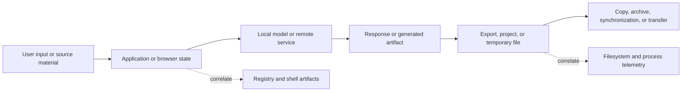
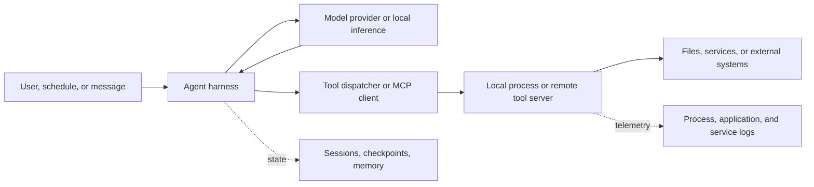

# Windows AI Artifact Forensics — Complete Write-up

**Single-file preview edition · Repository revision 1.2.0 · November 5, 2026**

This edition combines all 17 chapters, the overview, and the validation record. Workstation observations, synthetic cases, tested utilities, and pending application lab work retain their original labels.

## Contents

1. [Overview](#1-overview)

2. [Central artifact catalog](#2-central-artifact-catalog)

3. [Collection and analysis](#3-collection-and-analysis)

4. [Acquisition bundles and preservation templates](#4-acquisition-bundles-and-preservation-templates)

5. [Windows artifacts and Registry reference](#5-windows-artifacts-and-registry-reference)

6. [Secondary residue and alternate storage](#6-secondary-residue-and-alternate-storage)

7. [AI application storage](#7-ai-application-storage)

8. [Coding-agent CLI artifacts](#8-coding-agent-cli-artifacts)

9. [IDE coding-agent artifacts](#9-ide-coding-agent-artifacts)

10. [Agent harnesses and tool infrastructure](#10-agent-harnesses-and-tool-infrastructure)

11. [Image-generation and training artifacts](#11-image-generation-and-training-artifacts)

12. [Bounded static metadata inspection](#12-bounded-static-metadata-inspection)

13. [Media and transfer provenance](#13-media-and-transfer-provenance)

14. [Application to CSAM investigations](#14-application-to-csam-investigations)

15. [Observed workstation example](#15-observed-workstation-example)

16. [Expanded workstation example](#16-expanded-workstation-example)

17. [Synthetic worked cases](#17-synthetic-worked-cases)

18. [Application lab-validation plan](#18-application-lab-validation-plan)

19. [Validation record](#19-validation-record)


---

## 1. Overview

### 1. Reconstructing AI-assisted activity from files, application state, and the Registry

**Technical reference and sanitized workstation example. Research checked November 5, 2026.**

**Repository revision: 1.2.0.** Start with the [artifact catalog](#2-central-artifact-catalog), then follow the [worked cases](#17-synthetic-worked-cases) and [acquisition bundles](#4-acquisition-bundles-and-preservation-templates). Real workstation observations, synthetic cases, tested utilities, and pending application lab captures are labeled separately.

An AI application's visible export folder is only one part of its forensic footprint. A useful examination also considers conversation stores, model caches, temporary material, browser storage, shell interaction, and execution telemetry. Those sources answer different questions: what was available, what was requested, what ran, what was saved, and which account or operator can be connected to the activity.

This repository provides a Windows-focused approach for investigations involving malicious hacking, impersonation, coercion, and child exploitation. It uses an owner-authorized workstation as a metadata example. **The example is an ordinary workstation survey; it makes no finding of wrongdoing.** Private conversation contents, images, credentials, browsing records, account identifiers, and personal filenames are excluded.

### 1. Read the write-up

| Document | Coverage |
|---|---|
| [Central artifact catalog](#2-central-artifact-catalog) | Searchable path/format/inference/status index with a machine-readable JSON companion |
| [Acquisition bundles and templates](#4-acquisition-bundles-and-preservation-templates) | Related-file sets, capture limits, evidence manifests, and claim/evidence records |
| [Worked cases](#17-synthetic-worked-cases) | Two explicitly synthetic investigations, including cross-host joins and media handling |
| [Lab validation plan](#18-application-lab-validation-plan) | Reproducible benign application tests; actual application captures remain pending |
| [Static metadata inspection](#12-bounded-static-metadata-inspection) | Bounded header reader, benign measured fixture, malformed-input tests, and limits |
| [Media and transfer provenance](#13-media-and-transfer-provenance) | Derivative relationships, C2PA, cloud/remote actions, and transfer completion |
| [AI application storage](#7-ai-application-storage) | Ollama, LM Studio, Hugging Face, ComfyUI, AUTOMATIC1111, and browser/Electron storage |
| [Coding-agent CLI artifacts](#8-coding-agent-cli-artifacts) | Claude Code, Gemini CLI, Copilot CLI, OpenCode, Aider, transcripts, settings, and temporary/session state |
| [IDE-agent artifacts](#9-ide-coding-agent-artifacts) | Cursor, VS Code/Copilot, Cline, Roo Code, Continue, editor databases, and extension task stores |
| [Harnesses and tool infrastructure](#10-agent-harnesses-and-tool-infrastructure) | OpenClaw, Hermes, goose, OpenHands SDK, LangGraph, MCP, hooks, and cross-host correlation |
| [Additional image-generation artifacts](#11-image-generation-and-training-artifacts) | InvokeAI, Fooocus, Forge, SwarmUI, kohya_ss, OneTrainer, and Diffusers output/training storage |
| [CSAM investigation application](#14-application-to-csam-investigations) | Sourced misuse context, model/adapter provenance, generation-versus-import evidence, and attribution |
| [Windows artifact reference](#5-windows-artifacts-and-registry-reference) | Exact paths, Registry keys, hive mapping, event IDs, and interpretation limits |
| [Secondary residue and alternate storage](#6-secondary-residue-and-alternate-storage) | Thumbnails, temporary files, crash dumps, Recycle Bin, alternate streams, redirected folders, WSL, and Docker |
| [Observed workstation example](#15-observed-workstation-example) | Verified paths on the example computer, including inaccessible and stale locations |
| [Expanded workstation example](#16-expanded-workstation-example) | Additional verified Copilot, Roo Code, native Hermes, IDE, and tray-application candidates |
| [Collection and analysis](#3-collection-and-analysis) | Preservation, metadata inventory, SQLite analysis, timeline construction, and a benign example |
| [Inventory helper](scripts/Get-AIArtifactInventory.ps1) | Bounded current-user metadata survey; no content parsing |
| [Example JSON](examples/workstation-metadata.json) | Sanitized output from the helper on the example workstation |
| [Supplemental observations](examples/supplemental-observations.json) | Additional bounded checks and two allowlisted configuration path settings |
| [Expanded inventory JSON](examples/expanded-workstation-metadata.json) | Separate current-user snapshot from collector revision 1.1.0 |

**Inclusion rule:** the storage chapters document general-purpose software behavior. The CSAM investigation chapter separately cites documented misuse. A listed application, model cache, or harness is not itself an indicator of offending activity.

### 1. 1. Follow the data through the workflow

A practical starting model is:



Each arrow is a proposition to test. A folder containing a model and a script supports a different claim from a recovered request linked to a process event and a matching output file.

Use the following distinction throughout the examination:

| Finding | Example support | Remaining question |
|---|---|---|
| Availability | Model cache, application installation, configuration | Was the tool actually used? |
| Request or interaction | Conversation record, CLI input history, workflow graph | Was it submitted, imported, or merely stored? |
| Execution | Process telemetry and corroborating application records | Did the process perform the action of interest? |
| Output creation | Generated artifact, application record, filesystem activity | Which request or process produced it? |
| Distribution | Transfer records and destination-side corroboration | Did transfer complete, and who controlled the destination? |
| Attribution | Account/session evidence, device context, communications | Could automation, remote access, or another user explain it? |

Treat this table as an analytical framework. It is not a scoring system in which a fixed number of artifacts proves an allegation. Digital investigation depends on testing explanations against the available evidence, including competing explanations. [NIST's scientific foundation review](https://nvlpubs.nist.gov/nistpubs/ir/2022/NIST.IR.8354.pdf) discusses that approach.

### 1. 2. Search beyond Downloads and Pictures

The highest-value locations are often application-specific:

| Location class | Examples | Why examine it? |
|---|---|---|
| User-level application state | `%USERPROFILE%\.lmstudio\conversations`, `%USERPROFILE%\.codex\sessions` | Requests, session records, or related state may exist without a manual export |
| Desktop application data | `%APPDATA%\LM Studio`, application-specific `%LOCALAPPDATA%` trees | Separate state, local storage, logs, and caches |
| Model/repository cache | `%USERPROFILE%\.ollama\models`, `%USERPROFILE%\.cache\huggingface\hub` | Model/repository availability and revision context |
| Configured output roots | ComfyUI `output`; AUTOMATIC1111 `outdir_*` settings | Generated files may be written outside standard user folders |
| Browser profiles | `History`, `IndexedDB`, `Local Storage`, `Service Worker\CacheStorage` | Web access, retained application state, and download context |
| Windows interaction artifacts | Jump Lists, LNK files, ShellBags, dialog MRUs | References to locations and files outside the application's own records |

The [application reference](#7-ai-application-storage) supplies sources and configuration exceptions for these paths. A default is a search candidate. Establish the effective path from the examined installation.

Resolve environment variables for the target user. On an offline image, the analyst's `%APPDATA%` and `HKCU` refer to the analyst, not the subject profile. Record explicit image-relative paths and hive provenance.

### 1. 3. Keep configuration, data, and output separate

An examiner should establish at least four locations for each relevant application:

1. **Executable and version:** the program actually present at the relevant time.
2. **Configuration root:** settings, launch options, and path overrides.
3. **State and cache roots:** conversations, sessions, repositories, databases, or logs.
4. **Output destinations:** generated files, explicit exports, project files, and transfers.

These may reside on different volumes or in different user profiles. A Python wrapper can write a response to its working directory while the model cache remains elsewhere. A browser may retain a conversation reference without downloading a response. An image workflow can specify a filename prefix or a custom output directory.

Do not interpret every cache as a copy of user-generated content. Code caches and GPU caches have infrastructure roles. A model cache is ordinarily acquisition/availability evidence; the application or caller determines whether responses are saved.

### 1. 4. Reconstruct paths and event order

For NTFS, relate directory entries and file metadata to retained change records. The MFT holds file information; the USN journal records types of filesystem change and can discard older records. It is a partial history, with possible aggregation of changes. [Microsoft MFT documentation](https://learn.microsoft.com/en-us/windows/win32/fileio/master-file-table), [USN journal documentation](https://learn.microsoft.com/en-us/windows/win32/fileio/change-journal-records).

Correlate that layer with the exact Registry and execution artifacts listed in the [Windows reference](#5-windows-artifacts-and-registry-reference). Keep these distinctions explicit:

- A saved path reference supports a narrower claim than successful file access.
- A configured startup command supports a narrower claim than execution.
- Process creation supports a narrower claim than a successful generation or transfer.
- A key LastWrite time is a key-level timestamp, not a timestamp for every value.
- Timestamp disagreement deserves investigation before it is labeled manipulation.

Preserve the raw time representation, conversion method, source timezone, and any observed clock discrepancy. Copying, archive extraction, synchronization, and parser behavior can explain differences. Document the basis for each claimed event instead of merging every timestamp into an unexplained chronology.

### 1. 5. Handle databases as evidence sets

The example workstation contained versioned SQLite files under `.codex`, with adjacent `-wal` and `-shm` files. Their filenames are locally verified; their schemas and contents were not examined.

SQLite can retain committed changes in a WAL before they are checkpointed into the main database. A coherent acquisition must account for the database and relevant sidecars. Sequential copies from an actively changing application do not automatically constitute a consistent snapshot. Analyze acquired copies and preserve the original set. [SQLite WAL documentation](https://www.sqlite.org/wal.html).

Likewise, a directory named `Local Storage\leveldb` is not a SQLite database. Use a parser appropriate to the captured storage format and version. Avoid guessing a schema from an application name.

### 1. 6. What this computer actually demonstrated

The authorized survey observed:

- LM Studio conversation JSON and a separate roaming application-data tree.
- Ollama model storage and CLI history, while the checked local Ollama directory was empty.
- Codex session/state candidates, SQLite sidecars, attachments, and visualization directories.
- A ComfyUI CLI configuration referencing a workspace absent at the checked path.
- Zero direct files in the Windows Recent root, alongside files in both Jump List subdirectories.
- Access-denied results for protected artifacts that must remain distinct from absence.

These findings are explained in the [local example](#15-observed-workstation-example). Counts are live observations from November 5, 2026, not durable properties of the machine.

### 1. 7. Connect the workflow to the investigation

For a suspected intrusion, examine whether a recovered request relates to a particular script, whether that script ran, and whether execution aligns with activity on the affected system. For suspected exploitation, examine whether the supported workflow connects source material, communications, generated artifacts, and transfer activity to the harm being investigated.

Keep technical reconstruction and intent separate in the report. A model's presence, a folder label, an apparent prompt, or an embedded workflow graph cannot independently establish a person's actions or purpose.

Useful reporting language states both the observation and its limit:

> A JSON file was present in the application's documented conversation directory. Its contents were not examined in this survey; the observation establishes a candidate record for authorized analysis.

> The configuration referenced an output workspace absent at the checked location. The survey did not determine whether it had been moved, removed, or stored on an unavailable volume.

> No Sysmon EVTX file was observed at the checked default path. Historical installation, alternate destinations, and forwarded telemetry were not assessed.

### 1. Reproduce the metadata survey

Run from the repository root in Windows PowerShell or PowerShell:

```powershell
.\scripts\Get-AIArtifactInventory.ps1 -OutputPath .\inventory-private.json
```

The helper inspects a fixed current-user candidate list and reports metadata. Review its help before use. Running it on a live system generates normal operating-system and shell traces. Its output is an inventory, not an evidence acquisition or a malicious-activity detector.

The checked-in example deliberately omits private content. Keep case material outside a public repository.

The helper was validated in Windows PowerShell 5.1 and PowerShell 7. The [validation record](#19-validation-record) describes the checks and their limits.

Revision 1.1.0 adds coding-agent, editor, and harness candidates while preserving the initial observation files. It reports metadata and selected environment-variable presence; it does not resolve every custom root, parse private content, or search every project on disk.

Revision 1.2.0 adds the catalog, acquisition templates, synthetic worked cases, media/transfer guidance, and a tested static-header reader. See the [validation plan](#18-application-lab-validation-plan) before treating a documented application path or synthetic case as a reproduced application finding.

### 1. Maintenance

Paths and schemas change. Record the installed application version, effective configuration, source retrieval date, parser version, and acquisition method for each examination. Links to `main`, `master`, or `latest` document a moving implementation; pin the relevant commit when citing a particular build in a case report.


---

## 2. Central artifact catalog

**Checked: 2026-11-05.** This compact index links the storage chapters to a [searchable JSON catalog](catalog/artifacts.json). It is a selection of 40 high-value entries, not a complete product inventory or a list of indicators of wrongdoing. Resolve every path in the examined account, runtime, version, and effective configuration.

### 2. Evidence-status legend

| Label | JSON value | Meaning |
|---|---|---|
| D | `documented` | A documented default or candidate. No local presence is asserted. |
| S | `source_defined` | A reviewed implementation defines the candidate. Match that implementation to the installed version before applying it. |
| O | `observed_metadata` | The exact path was present in an existing example JSON. This establishes only the recorded metadata; payloads were not analyzed. |

An O label does not validate a parser, establish successful use, or prove that a file contains what its name suggests. Wildcard/session-specific templates are not marked observed merely because their parent root existed. D/S rows can also have negative checks in the workstation examples: their catalog status does not override those results. Missing at a checked default, inaccessible, and outside scope remain different observations.

For O rows, `observation_reference` identifies the checked-in JSON collection and the field containing an exact path/key match. Review that record's time, traversal bounds, errors, and limitations. The initial and expanded inventories are separate live observations.

### 2. Local models, conversations, and image workflows

| ID | Product / artifact | Status | Path or locator | Detail |
|---|---|---|---|---|
| `lmstudio-conversations` | LM Studio conversations | O | `%USERPROFILE%\.lmstudio\conversations` | [Storage](#7-lm-studio-conversations-and-models-are-distinct) |
| `lmstudio-models` | LM Studio models | O | `%USERPROFILE%\.lmstudio\models` | [Storage](#7-lm-studio-conversations-and-models-are-distinct) |
| `ollama-cli-history` | Ollama input history | S | `%USERPROFILE%\.ollama\history` | [Storage](#7-ollama-separate-models-desktop-chats-and-cli-history) |
| `ollama-desktop-db` | Ollama desktop database | S | `%LOCALAPPDATA%\Ollama\db.sqlite` | [Storage](#7-ollama-separate-models-desktop-chats-and-cli-history) |
| `huggingface-hub-cache` | Hub repository cache | D | `%USERPROFILE%\.cache\huggingface\hub` | [Storage](#7-hugging-face-repository-cache-is-not-generated-output) |
| `comfyui-output` | ComfyUI saved output | S | `<effective-base>\output` | [Storage](#7-comfyui-locate-the-effective-base-and-output-directories) |
| `comfyui-workflow-metadata` | ComfyUI embedded workflow | D | Optional fields inside a saved PNG | [Metadata](#7-comfyui-locate-the-effective-base-and-output-directories) |
| `a1111-output` | WebUI output | S | `<effective-data>\outputs\txt2img-images` | [Storage](#7-automatic1111-settings-determine-output-destinations) |
| `invokeai-db` | InvokeAI gallery/application DB | S | `<effective-root>\databases\invokeai.db` | [Image tools](#11-invokeai-gallery-files-and-database-state) |
| `fooocus-output-history` | Fooocus daily history | S | `<path_outputs>\YYYY-MM-DD\log.html` | [Image tools](#11-fooocus-dated-output-directories-and-a-local-html-history) |
| `swarmui-user-db` | SwarmUI account state | S | `<effective-data>\Users.ldb` — LiteDB | [Image tools](#11-swarmui-service-data-account-state-and-backend-boundaries) |
| `onetrainer-run-config` | OneTrainer run settings | S | `<workspace>\config\<prefix><timestamp>.json` | [Training](#11-onetrainer-a-run-workspace-can-retain-several-evidence-layers) |

### 2. Coding CLIs

| ID | Product / artifact | Status | Path or locator | Detail |
|---|---|---|---|---|
| `claude-transcripts` | Claude Code transcript | D | `.claude\projects\<project>\<session>.jsonl` under the effective home root | [CLI](#8-claude-code) |
| `claude-file-history` | Claude Code snapshots | D | `.claude\file-history\<session>` | [CLI](#8-claude-code) |
| `claude-memory` | Claude Code auto memory | D | `.claude\projects\<project>\memory` | [CLI](#8-claude-code) |
| `gemini-chats` | Gemini CLI sessions | D | `.gemini\tmp\<project_hash>\chats` | [CLI](#8-gemini-cli) |
| `copilot-cli-events` | Copilot session events | D | `.copilot\session-state\<session>\events.jsonl` | [CLI](#8-github-copilot-cli) |
| `copilot-cli-index` | Copilot cross-session index | D | `.copilot\session-store.db` | [CLI](#8-github-copilot-cli) |
| `copilot-cli-config` | Copilot state candidate | O | `%USERPROFILE%\.copilot\config.json` | [Observation](#16-2-copilot-had-configuration-and-a-log-candidate-but-no-checked-session-store) |
| `opencode-db` | OpenCode sessions | D | `.local\share\opencode\opencode.db` under the effective data root | [CLI](#8-opencode-xdg-paths-also-matter-on-windows) |
| `aider-chat-history` | Aider chat history | S | `<git-root-or-working-directory>\.aider.chat.history.md` | [CLI](#8-aider-look-inside-the-working-repository) |
| `codex-session-candidates` | Codex session directory | O | `%USERPROFILE%\.codex\sessions` | [Observation](#15-3-codex-had-multiple-local-state-candidates) |

These abbreviated directory names are display aids. Use each JSON row's full `path_template` and `environment` description before collection. A WSL or remote process has a different home and potentially a different evidence host.

### 2. Editors and extensions

| ID | Product / artifact | Status | Path or locator | Detail |
|---|---|---|---|---|
| `vscode-chat-sessions` | VS Code chat infrastructure | S | `<user-data>\User\workspaceStorage\<workspace>\chatSessions` | [IDE](#9-vs-code-and-github-copilot-session-files-and-editing-snapshots) |
| `vscode-editing-sessions` | VS Code editing state | S | Workspace `chatEditingSessions\<key>` | [IDE](#9-vs-code-and-github-copilot-session-files-and-editing-snapshots) |
| `cursor-global-state` | Cursor global state | D | `%APPDATA%\Cursor\User\globalStorage\state.vscdb` | [IDE](#9-cursor-global-and-workspace-state) |
| `cline-extension-tasks` | Cline extension-era tasks | S | VS Code global storage `saoudrizwan.claude-dev\tasks\<task>` | [IDE](#9-cline-extension-era-tasks-and-newer-home-based-storage) |
| `cline-sdk-db` | Cline home-based sessions | S | `%USERPROFILE%\.cline\data\db\sessions.db` | [IDE](#9-cline-extension-era-tasks-and-newer-home-based-storage) |
| `roo-tasks` | Roo Code task root | O | VS Code global storage `rooveterinaryinc.roo-cline\tasks` | [Observation](#16-3-vs-code-and-roo-code-candidates-were-present) |
| `continue-sessions` | Continue sessions | S | `%USERPROFILE%\.continue\sessions` | [IDE](#9-continue-a-separate-home-directory) |

### 2. Harnesses and gateways

| ID | Product / artifact | Status | Path or locator | Detail |
|---|---|---|---|---|
| `openclaw-runtime-db` | OpenClaw Gateway state | D | `<state>\agents\<agent>\agent\openclaw-agent.sqlite` | [Harness](#10-openclaw-current-database-versus-legacy-session-files) |
| `hermes-state-db` | Native Hermes state | O | `%LOCALAPPDATA%\hermes\state.db` | [Observation](#16-4-native-hermes-state-differed-from-the-unix-style-home-candidate) |
| `goose-sessions-db` | goose shared sessions | D | `%APPDATA%\Block\goose\data\sessions\sessions.db` | [Harness](#10-goose-shared-conversation-store-separate-operational-logs) |

### 2. Browser and Windows corroboration

| ID | Product / artifact | Status | Path or locator | Detail |
|---|---|---|---|---|
| `chrome-history` | Chrome History candidate | O | Checked `Default\History` file | [Observation](#15-5-browser-profiles-contained-multiple-storage-classes) |
| `chrome-local-storage` | Chrome local-storage candidate | O | Checked `Default\Local Storage\leveldb` directory | [Observation](#15-5-browser-profiles-contained-multiple-storage-classes) |
| `windows-automatic-jumplists` | Automatic Jump List root | O | `%APPDATA%\Microsoft\Windows\Recent\AutomaticDestinations` | [Windows](#5-shortcuts-jump-lists-and-program-artifacts) |
| `windows-open-save-mru` | Dialog MRU root | O | Account `HKCU\...\Explorer\ComDlg32\OpenSavePidlMRU` | [Windows](#5-shell-history-and-file-dialog-references) |
| `windows-modern-shellbags` | Modern BagMRU root | O | Account `HKCU\Software\Classes\Local Settings\...\Shell\BagMRU` | [Windows](#5-shellbags-and-userassist-interpretation) |
| `windows-prefetch` | Prefetch | D | `%SystemRoot%\Prefetch\*.pf` | [Windows](#5-shortcuts-jump-lists-and-program-artifacts) |
| `windows-amcache` | Amcache | D | `%SystemRoot%\appcompat\Programs\Amcache.hve` | [Windows](#5-shortcuts-jump-lists-and-program-artifacts) |
| `windows-sysmon-events` | Sysmon Operational EVTX | D | Sysmon channel/file, subject to configuration | [Windows](#5-event-logs-and-existing-logging-policy) |

The Registry entries above are keys, not filenames. Use the complete JSON template and detail chapter for exact key/hive mapping. Directory observations also differ from the wildcard file candidates stored beneath them.

### 2. Search and interpret the JSON

From the repository root, this reads only the catalog:

```powershell
$artifactCatalog = Get-Content -LiteralPath '.\catalog\artifacts.json' -Raw | ConvertFrom-Json
$artifactCatalog.artifacts |
    Where-Object { $_.product -match 'Claude|Copilot' } |
    Select-Object id, evidence_status, path_template, storage_format

$artifactCatalog.artifacts |
    Where-Object { $_.evidence_status -eq 'observed_metadata' } |
    Select-Object id, path_template, observation_reference
```

Every row supplies a source URL, source revision or retrieval date, supported claims, limits, and a suggested `collection_bundle`. The bundle is a preservation checklist, not a collection command or proof of coherent capture. Read [collection and analysis](#3-collection-and-analysis) before choosing an acquisition method. Referenced files can contain credentials, personal material, or other sensitive data even when only their paths appear here.

For moving references, record the installed version and relevant source commit. For observed rows, preserve the original example record as provenance rather than replacing its historical result with a later live lookup. Add a lab-validation claim only after capturing benign fixtures and recording the exact conditions and expected findings.


---

## 3. Collection and analysis

This workflow turns a directory survey into a set of testable findings. The commands below are lab/analysis examples. No conversation, browser, image, event, or Registry-value contents from the example workstation were analyzed to produce this repository.

### 3. 1. Choose the acquisition product before collecting

Decide whether the examination requires live triage, a logical collection, a filesystem/volume acquisition, or memory capture. Record the authority, scope, source, collector version, time, timezone, and acquisition method.

A live metadata survey is useful for locating candidates. It does not preserve deleted records, unallocated space, locked hives, alternate streams, or a coherent database transaction state. The included helper deliberately does not attempt raw-volume access or elevation.

Use an established acquisition process for the required evidence. Preserve originals, work from verified copies, and document transformations. NIST describes collection, examination, analysis, and reporting as separate forensic activities. [NIST SP 800-86](https://csrc.nist.gov/pubs/sp/800/86/final).

Keep examination-generated traces in the timeline. Starting a shell, reading directories, writing a report, launching a viewer, or closing an application can affect the live system. Do not silently treat those events as preexisting subject activity.

### 3. 2. Resolve storage in the target account's context

Record:

- Examined Windows profile and hive provenance.
- Executable path, version, and relevant launch configuration.
- User, machine, and process path overrides where available.
- Junctions, symbolic links, redirected known folders, and unavailable volumes.
- Whether a tool runs on Windows, in WSL, in a container, or on a remote system.

The current environment cannot establish every historical process environment. A configuration reference to `D:\outputs` does not establish that the volume was attached or that the application wrote a file there.

The included survey reports only whether selected override names are set. It does not disclose their values and does not resolve application settings. Manually following a redirect is a separate examination step, with its own scope and recorded result.

See [secondary residue and alternate storage](#6-secondary-residue-and-alternate-storage) for known-folder redirection, virtual disks, and related candidates.

### 3. 3. Run the bounded metadata inventory

From the repository root:

```powershell
.\scripts\Get-AIArtifactInventory.ps1 -OutputPath .\inventory-private.json
```

Use a new destination. The helper refuses to overwrite an existing output file. It runs as the current account and returns a fixed list of candidate paths and keys, direct directory statistics, known-file metadata, browser artifact metadata, and environment-presence booleans.

It does not:

- Parse conversations, browser databases, logs, images, or model files.
- Export Registry values, personal filenames, hostnames, or SIDs.
- Traverse arbitrary directory trees or follow reparse-point paths.
- Detect wrongdoing or establish a complete application inventory.

Interpret statuses literally. `access_denied` means the query was blocked. `not_found_at_checked_path` describes a particular lookup. Neither status answers whether an artifact exists somewhere else.

Counts are also narrow: direct-file counts exclude descendant directories; immediate subkey counts are not counts of actions. The checked-in example is [sanitized JSON](examples/workstation-metadata.json), not raw case evidence.

### 3. 4. Preserve database and hive context

Acquire SQLite artifacts coherently, including relevant WAL/SHM files. A database, its WAL, and its SHM belong to a captured state; a simple sequential live copy can race ongoing writes. Preserve the acquired set and parse disposable analysis copies.

Do not checkpoint, vacuum, repair, or open the original application against original evidence merely to make a database convenient to read. The WAL may contain changes missing from the main file. [SQLite WAL behavior](https://www.sqlite.org/wal.html).

For Registry evidence, retain the hive and relevant transaction logs. Record whether a parser replayed logs or recovered data, and keep the pre-recovery originals. Live Registry queries and offline hive parsing can yield different views.

If hashing an acquired analysis file:

```powershell
$analysisCopy = 'E:\analysis\acquired\History'
Get-FileHash -LiteralPath $analysisCopy -Algorithm SHA256
```

This computes a file hash; it does not prove completeness, coherent capture, authorship, or unchanged source state during acquisition. [Get-FileHash documentation](https://learn.microsoft.com/en-us/powershell/module/microsoft.powershell.utility/get-filehash?view=powershell-7.5).

### 3. 5. Examine schemas before writing queries

On a disposable analysis copy, using an already-available SQLite CLI:

```powershell
sqlite3 -readonly 'E:\analysis\Chrome\History' '.tables'
sqlite3 -readonly 'E:\analysis\Chrome\History' '.schema downloads'
sqlite3 -readonly 'E:\analysis\Chrome\History' '.schema downloads_url_chains'
```

The read-only option limits writes to the opened database. It is not a substitute for preserving originals; journal handling, temporary files, and tool behavior still belong on the analysis side of the workflow. [SQLite CLI documentation](https://www.sqlite.org/cli.html).

After verifying that the captured schema has the referenced columns, run:

```powershell
sqlite3 -readonly 'E:\analysis\Chrome\History' '.read queries/chromium-downloads.sql'
```

The [example query](queries/chromium-downloads.sql) returns recorded current/target paths, download state, byte counts, source timing values, and redirect-chain records. It intentionally retains raw timestamp values; convert them using a validated parser or conversion appropriate to that schema.

These columns are defined in Chromium's [download database implementation](https://chromium.googlesource.com/chromium/src/+/main/components/history/core/browser/download_database.cc). A target path is a recorded destination. Establish completion using state, received/expected bytes where meaningful, and corroborating filesystem evidence. A successful download still does not establish AI generation or later human review.

For application databases such as the observed Codex SQLite candidates, use `.tables` and `.schema` on acquired copies first. Do not invent a universal `messages` table or reuse a query merely because another application also uses SQLite.

### 3. 6. Parse non-SQLite artifacts with the right tools

| Artifact | Appropriate examination |
|---|---|
| `Local Storage\leveldb`, IndexedDB storage | Format-aware parser; preserve related files and sequence context |
| Conversation JSON/JSONL | Validate the application version, record type, role, identifiers, and timestamps |
| Compressed session candidates | Identify the compression/container first; record decompression tool and hash both forms |
| Workflow-bearing images | Extract metadata on analysis copies; retain raw fields before interpreting nodes |
| LNK / Jump Lists | Parse container records, target metadata, and application identifiers separately |
| User Registry hives | Parse hive-relative keys with the appropriate source hive and transaction context |

A browser cache entry may be a resource, an error response, or stale application data. A saved conversation may have been imported or edited. An embedded workflow may describe parameters without proving that the local machine executed it. Evaluate provenance before assigning behavior.

Original tool-author references for Windows parsing include [RECmd](https://github.com/EricZimmerman/RECmd), [LECmd](https://github.com/EricZimmerman/LECmd), [JLECmd](https://github.com/EricZimmerman/JLECmd), and [PECmd](https://github.com/EricZimmerman/PECmd). Match the parser to the artifact and record the exact version used. These tools were not run against private payloads for this example.

### 3. 7. Build a timeline that preserves the claim behind each row

Use fields such as:

```text
source_artifact
source_path_or_acquisition_id
record_identifier
raw_timestamp
timestamp_semantics
normalized_utc
account_or_session_context
process_or_file_identifier
observation
supported_claim
limitations
```

Separate host filesystem times from embedded record times. Preserve a process identifier with enough context to handle PID reuse. Distinguish a directory-entry rename from a content modification, and a configured action from its successful completion.

Avoid deriving a whole sequence from one shared timestamp or basename. Use content hashes where they genuinely establish byte identity, and document when identity cannot be established.

### 3. 8. Benign reconstruction example

**The sequence below is synthetic. It was not observed on the example computer.**

A recovered conversation requests a CSV parsing utility. A script named `csv_report.py` appears in a project, a process event records Python launching that path, and a report file appears shortly afterward.

| Evidence | Supported observation | Additional work |
|---|---|---|
| Conversation request | A record contains the request | Establish provenance, submission status, account/session, and record integrity |
| Project script | A candidate script exists | Compare its content with the recorded response; check for later edits |
| Process record | A process launched with that command line | Resolve executable, working directory, parent/session context, and retention gaps |
| Filesystem record | The report was created/changed | Link the write to the process where telemetry permits |
| Archive or transfer record | A path or transfer is recorded | Establish file identity, completion, and destination control |

Only state the relationships supported by the examined evidence. Byte-identical script content can support a link to a response, but copied files and imported conversations remain alternatives to investigate.

### 3. 9. Keep the publication separate from the case record

A public write-up can show generic paths, artifact types, sanitized metadata, benign lab markers, and documented limits. Private evidence should remain in the authorized evidence store.

Before publishing an example, review filenames, screenshots, paths, URLs, conversation titles, account identifiers, access tokens, and recovered content. A path reference can identify a person even when the file payload is omitted.

This repository includes only generic path aliases and bounded workstation observations. The source-specific reference pages identify documented candidates; the local example identifies which candidates were actually checked.


---

## 4. Acquisition bundles and preservation templates

A useful acquisition preserves the files and relationships needed to interpret a captured state. A bundle groups those artifacts under one acquisition identifier; it does not assert that every member was captured simultaneously or that the bundle is complete.

The included PowerShell inventory **does not acquire these bundles**. It surveys selected live metadata and writes a report. The recipes below describe requirements for a separately selected acquisition process. No private conversations, images, model contents, or Registry values were acquired to prepare this repository. Reference review date: **2026-11-05**.

### 4. Assign identities before analysis

Create a source acquisition ID, a bundle ID, and an artifact ID for each retained file. Preserve the exact source-to-destination mapping in the private case record; use host, account, volume, and path aliases in public material. An alias identifies context without asserting a person's identity.

Keep three products distinct:

1. **Source acquisition:** the preserved acquisition product, with its method, scope, time range, and limitations.
2. **Analysis copy:** a verified derivative assigned its own ID and linked to the source artifact IDs.
3. **Analytical export:** parsed rows, recovered records, decoded metadata, or rendered previews, with a transformation record and output hashes.

Record whether a hash covers a physical acquisition container, an extracted file, a named stream, or a transformed export. Equal hashes support byte identity of the hashed objects, not completeness, coherent capture, authorship, or successful execution.

### 4. Establish the consistency boundary

Choose and document the consistency mechanism before copying active stores. A sequence of file copies can span multiple application states even when every copy succeeds. Record source activity, acquisition start/end times, included volumes, and any freeze, snapshot, or application coordination.

Windows VSS coordinates requesters, writers, and providers. A successful snapshot operation should not be reported as application-consistent without evidence of the relevant coordination. Preserve snapshot IDs and writer/provider results where available, and identify stores outside the captured volume set. See [Microsoft's VSS description](https://learn.microsoft.com/en-us/windows-server/storage/file-server/volume-shadow-copy-service).

Stopping an application may flush buffers, checkpoint databases, rotate logs, or change history. If quiescing is required by the chosen process, document that intervention and its effects. An offline source also needs a recorded provenance and acquisition time; “offline” alone does not establish a clean shutdown.

### 4. SQLite bundle

For a database named `<database>`, retain the observed members and their relative names:

```text
<database>
<database>-wal
<database>-shm
<database>-journal
```

Record a status for each candidate: captured, absent at the checked path, inaccessible, not applicable, or outside scope. Do not manufacture empty sidecars. A WAL can contain committed state absent from the main file. The SHM file is a WAL index with no persistent database content, but retaining an existing copy preserves capture context. Rollback journals serve a different role. [SQLite's temporary-file documentation](https://www.sqlite.org/tempfiles.html) explains these distinctions.

Keep database and relevant journals from the same captured state. Mixing an earlier database with a later WAL can invalidate interpretation. SQLite specifically documents hazards from copying during transactions and mispairing journals. See its [backup and journal consistency guidance](https://www.sqlite.org/howtocorrupt.html).

If a supported database backup mechanism produces a coherent database snapshot, label it as that product and record its method. The [SQLite Online Backup API](https://www.sqlite.org/backup.html) supplies a database snapshot; it is not a filesystem acquisition of every original journal or historical fragment.

Also preserve separately referenced attachment or blob stores when required for the question. Record unresolved references explicitly. On analysis copies, capture schema, parser/SQLite version, query text, transaction or recovery behavior, and whether results came from current records or recovered fragments. Never silently merge results from incompatible captures.

### 4. LevelDB and browser storage bundle

Acquire the database directory as a set, retaining actual names, relative paths, and directory metadata. Candidates include `CURRENT`, `MANIFEST-*`, numbered `.log` files, table files such as `.ldb`, informational `LOG`/`LOG.old`, and any other files present. Include associated external blob directories identified by that application's storage design.

The original [LevelDB implementation notes](https://raw.githubusercontent.com/google/leveldb/main/doc/impl.md) explain that `CURRENT` identifies a manifest, while logs and tables represent related database state. Selecting only `.ldb` files discards that context. Compaction and recovery can change which files participate in the current view; opening a working store with a normal database library can therefore alter it.

Parse disposable copies with a format-aware tool. Preserve keys, sequence information, deletion markers, origin mapping, and parser warnings where available. Distinguish an active logical value from an older retained fragment. A browser profile, extension origin, and external blob reference must remain connected to their respective records. An inaccessible blob is a limitation, not an empty attachment.

### 4. JSON, JSONL, and agent session bundle

Preserve original bytes, encoding, filename, relative directory, and filesystem metadata before decoding. Group a session index, individual transcript files, task metadata, tool-result files, and referenced attachments when the application uses them. Keep parent/subagent relationships and identifiers rather than flattening all records into one conversation.

A JSONL line can represent an event, a state mutation, or part of another application-specific structure. Validate the recorded application version and schema; see the distinctions in [IDE agent artifacts](#9-ide-coding-agent-artifacts). An index can reference a missing file without supplying its contents.

For analysis, retain byte offsets or original line numbers, parsing failures, and any incomplete trailing data. Record decompression, decoding, mutation replay, or reconstruction as transformations with new output IDs. Do not repair an original, reorder lines, or discard malformed fragments without documenting what changed. An imported transcript and a locally recorded session remain different provenance possibilities.

### 4. Registry bundle

Preserve the relevant hive and associated transaction logs from the chosen acquisition product. For user activity, maintain the account association and distinguish `NTUSER.DAT` from `UsrClass.dat`. Record the original hive name, source volume, snapshot provenance, and selected Registry view. Microsoft's [hive documentation](https://learn.microsoft.com/en-us/windows/win32/sysinfo/registry-hives) identifies backing files and transaction logs; [Windows artifact references](#5-windows-artifacts-and-registry-reference) map the relevant paths and views.

A text `.reg` export records a different product from a hive acquisition. The [reg export documentation](https://learn.microsoft.com/en-us/windows-server/administration/windows-commands/reg-export) describes export of keys, entries, and values. Do not treat that output as preservation of every hive structure or historical record.

Replay or recovery belongs on a derivative. Record the parser version, log files supplied, recovery options, warnings, and before/after hashes. Keep hive key LastWrite, embedded artifact times, and filesystem timestamps separately labeled.

### 4. Image, workflow, and model bundle

Retain the original image or media bytes, embedded metadata, any separate workflow/project file, relevant effective configuration, and application-generated history that links them. Record external input paths, model references, adapters, custom components, and output references. Preserve available referenced files under separate artifact IDs; record missing, remote, or out-of-scope dependencies. Product-specific candidates appear in [image-generation artifacts](#11-image-generation-and-training-artifacts) and [AI storage](#7-ai-application-storage).

A filename such as `model.safetensors` is insufficient to establish exact weights. Hash acquired model files, record their sizes and container formats, and distinguish them from download manifests or cached aliases. A visual preview is not a replacement for original image bytes or metadata. Redaction, transcoding, resizing, and metadata extraction each produce a separately identified derivative.

Configuration and workflow references describe intended relationships. They do not establish that the specified files were available, that those exact weights were loaded, or that a run completed. Link outcomes to logs, recorded tool results, process evidence, and matching output files as available.

### 4. Complete the manifest and claim record

Use [the evidence manifest template](templates/evidence-manifest.template.json) to record bundle membership, source and analysis IDs, acquisition method, time semantics, per-file hashes, external references, transformations, and limitations. `null` hashes mean unrecorded, never “verified.” Replace placeholders and add one artifact record per retained file or stream. Keep observed absence separate from failed access.

Use [the claim-evidence template](templates/claim-evidence.template.json) for each material claim. Supply an exact source locator, analysis-run ID, observation, inferential step, alternatives, contradictory evidence, and unresolved limits. Preserve raw timestamps with their source type, units, epoch, timezone context, and clock uncertainty before adding normalized UTC values. Account aliases identify recorded context; attribution to an operator requires additional support.

Verify analysis-copy hashes against their preserved parents, record all parser versions and parameters, and retain warnings. A complete manifest makes the work reviewable; it does not eliminate limitations in the underlying acquisition.


---

## 5. Windows artifacts and Registry reference

This reference maps Windows evidence sources to questions about AI-assisted cybercrime, coercion, and child exploitation. It describes candidate examination locations, not findings from any particular computer. Resolve environment variables for the examined profile and installation. An investigator's `HKCU`, `%APPDATA%`, or `%TEMP%` can point somewhere different from the subject account.

All linked sources were retrieved on **2026-11-05**. Paths, schemas, logging behavior, and retention depend on the Windows and application versions. Record those versions alongside the acquisition method and parser versions.

### 5. Profile hives and live Registry views

| On-disk file | Corresponding live view | Purpose |
|---|---|---|
| `%USERPROFILE%\NTUSER.DAT` | `HKU\<SID>` and that account's `HKCU` view | User preferences and shell activity |
| `%LOCALAPPDATA%\Microsoft\Windows\UsrClass.dat` | `HKU\<SID>_Classes`; exposed through `HKCU\Software\Classes` | Per-user classes and shell state |
| `%SystemRoot%\System32\config\SOFTWARE` | `HKLM\SOFTWARE` | Machine software configuration |
| `%SystemRoot%\System32\config\SYSTEM` | `HKLM\SYSTEM` | System configuration |

Preserve the corresponding transaction logs when available, including `.LOG1` and `.LOG2`, and retain untouched originals before any recovery or replay. A mounted live view and a file copied from disk are different acquisition products. Microsoft documents [Registry hive backing files](https://learn.microsoft.com/en-us/windows/win32/sysinfo/registry-hives), while its [profile documentation](https://github.com/MicrosoftDocs/SupportArticles-docs/blob/main/support/windows-server/user-profiles-and-logon/desktop-location-unavailable.md) identifies modern user-hive placement.

`HKCR` merges machine and user class registrations; it is not an additional independent hive. Record which source supplies a relevant setting rather than reporting only the merged result. See [Microsoft's HKCR documentation](https://learn.microsoft.com/en-us/windows/win32/sysinfo/hkey-classes-root-key).

### 5. Shell history and file-dialog references

The following live keys belong to the relevant account. For offline `NTUSER.DAT` parsing, remove the `HKCU\` prefix and use the remaining hive-relative path.

| Artifact | Exact live key | Useful question |
|---|---|---|
| RecentDocs | `HKCU\Software\Microsoft\Windows\CurrentVersion\Explorer\RecentDocs` | Which document references remain in shell history? |
| Open/save dialogs | `HKCU\Software\Microsoft\Windows\CurrentVersion\Explorer\ComDlg32\OpenSavePidlMRU` | Which file or folder references appear in common dialogs? |
| Last dialog location | `HKCU\Software\Microsoft\Windows\CurrentVersion\Explorer\ComDlg32\LastVisitedPidlMRU` | Which application and directory references are associated? |
| Explorer searches | `HKCU\Software\Microsoft\Windows\CurrentVersion\Explorer\WordWheelQuery` | Which search strings were retained? |
| Run dialog | `HKCU\Software\Microsoft\Windows\CurrentVersion\Explorer\RunMRU` | Which command strings were submitted through Run? |
| Typed navigation | `HKCU\Software\Microsoft\Windows\CurrentVersion\Explorer\TypedPaths` | Which paths were typed into Explorer? |
| UserAssist | `HKCU\Software\Microsoft\Windows\CurrentVersion\Explorer\UserAssist\{GUID}\Count` | What GUI-related program metadata remains? |

These locations and hive assignments appear in the original [RECmd batch definitions](https://github.com/EricZimmerman/RECmd/blob/master/BatchExamples/RECmd_Batch_MC.reb). An absent key can reflect application behavior, configuration, retention, or version differences; record it as absent at examination rather than concluding that the associated activity never occurred.

RecentDocs has a root list and extension-specific subkeys. Preserve the value names, parsed target names, and `MRUListEx` ordering. The original [RecentDocs parser](https://github.com/EricZimmerman/RegistryPlugins/blob/master/RegistryPlugin.RecentDocs/RecentDocs.cs) demonstrates these structures. Matching a basename is weaker than matching a full path, file identifier, or content hash.

OpenSavePidlMRU contains shell-item data that can expose path components and embedded metadata. LastVisitedPidlMRU can associate an executable name with shell-item directory references. Their original [OpenSavePidlMRU](https://github.com/EricZimmerman/RegistryPlugins/blob/master/RegistryPlugin.OpenSavePidlMRU/OpenSavePidlMRU.cs) and [LastVisitedPidlMRU](https://github.com/EricZimmerman/RegistryPlugins/blob/master/RegistryPlugin.LastVisitedPidlMRU/LastVisitedPidlMRU.cs) parsers provide implementation references. A dialog reference needs corroboration before claiming that an upload, successful save, or content review occurred.

WordWheelQuery is Explorer search history, not general browser or AI prompt history. Its [parser](https://github.com/EricZimmerman/RegistryPlugins/blob/master/RegistryPlugin.WordWheelQuery/WordWheelQuery.cs) associates the key timestamp with the most recent ordered item, rather than assigning that time to every search.

### 5. ShellBags and UserAssist interpretation

Modern ShellBags commonly reside at these **UsrClass.dat-relative** locations:

```text
Local Settings\Software\Microsoft\Windows\Shell\BagMRU
Local Settings\Software\Microsoft\Windows\Shell\Bags
```

Their live equivalents begin with `HKU\<SID>_Classes\`, or with `HKCU\Software\Classes\` for that account. Also examine these **NTUSER.DAT-relative** locations when present:

```text
Software\Microsoft\Windows\Shell\BagMRU
Software\Microsoft\Windows\Shell\Bags
```

The original [ShellBags Explorer discussion](https://github.com/EricZimmerman/Issues/issues/22) illustrates bag hierarchy, parent relationships, and timestamp interpretation. Preserve node relationships and decoded shell-item details rather than flattening everything into an unexplained list of directory names.

ShellBags describe shell interaction and view state; command-line navigation is outside their coverage. Folder-property changes can also create entries. UserAssist value names use ROT13 encoding. On modern Windows, “Open file location” can update UserAssist count and time fields without launching the executable. Correlate focus data and independent telemetry. These cautions are documented in [Microsoft's DFIR guide](https://cdn-dynmedia-1.microsoft.com/is/content/microsoftcorp/microsoft/final/en-us/microsoft-brand/documents/IR-Guidebook-Final.pdf).

### 5. Shortcuts, Jump Lists, and program artifacts

| Artifact | Candidate path | Examination role |
|---|---|---|
| Recent shortcuts | `%APPDATA%\Microsoft\Windows\Recent\*.lnk` | Target and interaction context |
| Automatic Jump Lists | `%APPDATA%\Microsoft\Windows\Recent\AutomaticDestinations\*.automaticDestinations-ms` | Application-linked recent or frequent items |
| Custom Jump Lists | `%APPDATA%\Microsoft\Windows\Recent\CustomDestinations\*.customDestinations-ms` | Application-managed destination references |
| Prefetch | `%SystemRoot%\Prefetch\*.pf` | Program execution context, when available |
| Amcache | `%SystemRoot%\appcompat\Programs\Amcache.hve` | Program inventory and presence |

These paths are documented in [Microsoft's DFIR guide](https://cdn-dynmedia-1.microsoft.com/is/content/microsoftcorp/microsoft/final/en-us/microsoft-brand/documents/IR-Guidebook-Final.pdf). Amcache presence alone cannot establish execution. Prefetch availability varies; Windows Server commonly lacks it by default. A shortcut's own filesystem times and its embedded target metadata represent different objects and need separate labels in a timeline.

For example, a reference to `output.png` in a shortcut and another file with that basename in Downloads do not establish identity. Compare available target paths, volume information, file identifiers, sizes, and hashes. Treat unresolved identity as an explicit limitation, particularly when a file was renamed or moved.

### 5. Startup configuration

Examine all four standard locations:

```text
HKCU\Software\Microsoft\Windows\CurrentVersion\Run
HKCU\Software\Microsoft\Windows\CurrentVersion\RunOnce
HKLM\Software\Microsoft\Windows\CurrentVersion\Run
HKLM\Software\Microsoft\Windows\CurrentVersion\RunOnce
```

Run values configure repeated logon startup; RunOnce values configure a one-time action with deletion behavior. Machine RunOnce has account and logon conditions. Record value names, types, and command strings, but distinguish configuration from successful execution. Legitimate updaters and collaboration applications use these same keys. [Microsoft's Run/RunOnce documentation](https://learn.microsoft.com/en-us/windows/win32/setupapi/run-and-runonce-registry-keys) explains the behavior. This reference intentionally supplies no commands to create or modify these entries.

### 5. Event logs and existing logging policy

| Source | Channel or file | Useful events and requirements |
|---|---|---|
| Windows Security | `%SystemRoot%\System32\winevt\Logs\Security.evtx` | 4688 process creation; Audit Process Creation must be enabled |
| Windows PowerShell | `Microsoft-Windows-PowerShell/Operational` | 4104 script-block logging |
| PowerShell 7 | `PowerShellCore/Operational` | 4104; separate provider and configuration |
| Sysmon | `Microsoft-Windows-Sysmon/Operational` | 1 process creation; 3 network; 11 file create; 12–14 Registry operations |

[Event 4688 documentation](https://learn.microsoft.com/en-us/windows/security/threat-protection/auditing/event-4688) explains process and account fields. Command-line data additionally depends on the policy mapped to:

```text
HKLM\Software\Microsoft\Windows\CurrentVersion\Policies\System\Audit
    ProcessCreationIncludeCmdLine_Enabled
```

The value does not substitute for enabled process-creation auditing. Configuration at examination time also does not establish what was configured during the incident. See [Microsoft's audit policy mapping](https://learn.microsoft.com/en-us/windows/client-management/mdm/policy-csp-admx-auditsettings).

For Windows PowerShell, inspect existing settings at:

```text
HKLM\Software\Policies\Microsoft\Windows\PowerShell\ScriptBlockLogging
    EnableScriptBlockLogging
HKCU\Software\Policies\Microsoft\Windows\PowerShell\ScriptBlockLogging
    EnableScriptBlockLogging
```

[Microsoft's policy documentation](https://learn.microsoft.com/en-us/windows/client-management/mdm/policy-csp-windowspowershell) describes computer-policy precedence. [PowerShell 7 logging documentation](https://learn.microsoft.com/en-us/powershell/module/microsoft.powershell.core/about/about_logging_windows?view=powershell-7.5) documents its separate channel. Preserve multipart script blocks and their identifiers before reconstructing text. Logged script processing still requires context to determine which operations completed.

[Sysmon documentation](https://learn.microsoft.com/en-us/sysinternals/downloads/sysmon) defines its event semantics. Its service must have been installed, relevant events enabled and retained, and filters applicable. Network event 3 is disabled by default. Use ProcessGUID where available to reduce ambiguity from reused process IDs. Enabling logging after an incident supplies no historical records.

### 5. Command history and timestamp boundaries

PSReadLine's default Windows location is:

```text
%APPDATA%\Microsoft\Windows\PowerShell\PSReadLine\<HostName>_history.txt
```

`ConsoleHost_history.txt` is a common instance; hosts can use other names, and configuration can redirect storage. [Microsoft's PSReadLine documentation](https://learn.microsoft.com/en-us/powershell/module/psreadline/about/about_psreadline?view=powershell-7.5) also demonstrates adding a history entry without execution. History is therefore a lead for corroboration, not an execution audit. Saving mode, filtering, and host behavior affect coverage.

Registry LastWrite is a key-level timestamp for changes to the key or its value entries. It is not an independent timestamp for every value. [RegQueryInfoKeyW documentation](https://learn.microsoft.com/en-us/windows/win32/api/winreg/nf-winreg-regqueryinfokeyw) defines that boundary. Preserve raw timestamp values, the conversion method, and the displayed timezone in analytical exports.

Report separate findings for artifact presence, application execution, demonstrated AI involvement, completed actions, and operator attribution. An account name identifies a security context. Shared sessions, remote control, background tasks, and automation remain alternative explanations to evaluate with corroborating records.


---

## 6. Secondary residue and alternate storage

An application can save a deliverable in one directory while the operating system, browser, runtime, or virtual environment retains related material elsewhere. These are **documented examination candidates, not observed findings** from the example workstation. Sources were retrieved on **2026-11-05**. Their presence does not establish AI involvement, intent, or operator identity.

### 6. Explorer thumbnail databases

```text
%LOCALAPPDATA%\Microsoft\Windows\Explorer\thumbcache_*.db
```

This path and file mask appear in the original [KAPE ThumbCache target](https://github.com/EricZimmerman/KapeFiles/blob/master/Targets/Windows/ThumbCache.tkape). The [libwtcdb format specification](https://github.com/libyal/libwtcdb/blob/main/documentation/Windows%20Explorer%20Thumbnail%20Cache%20database%20format.asciidoc) documents multiple cache formats and size categories. Use a parser compatible with the acquired format.

A thumbnail is a derived representation, not the original file. Its appearance alone cannot establish who created the source, whether AI generated it, or its complete contents. Associate cache identifiers with independent path evidence where possible. [Thumbcache Viewer's author](https://thumbcacheviewer.github.io/) documents mapping against Windows Search databases and notes that mapping methods have operating-system and source-system dependencies. Preserve provenance for both the database and any extracted preview.

### 6. Temporary storage

```text
%TEMP%
%TMP%
%LOCALAPPDATA%\Temp\
```

The last path is a common candidate, not a universal location. Runtime and account context matter: [Microsoft's GetTempPath documentation](https://learn.microsoft.com/en-us/windows/win32/api/fileapi/nf-fileapi-gettemppatha) describes environment-based resolution. Modern [.NET temp-path behavior](https://learn.microsoft.com/en-us/dotnet/api/system.io.path.gettemppath?view=net-10.0) can use GetTempPath2 instead.

Application working copies, interrupted downloads, staging files, and intermediate renders are hypotheses to test here. A `.tmp` extension does not identify format or purpose; inspect acquired content using appropriate tools. Compare candidate files with output hashes, application records, and timestamps. An empty temp directory at examination time says little about earlier activity.

### 6. Crash dumps and application memory

```text
%LOCALAPPDATA%\CrashDumps\
HKLM\SOFTWARE\Microsoft\Windows\Windows Error Reporting\LocalDumps
HKLM\SOFTWARE\Microsoft\Windows\Windows Error Reporting\LocalDumps\<Application.exe>
```

Microsoft documents `DumpFolder` as an expandable path, `DumpType` as custom (`0`), mini (`1`), or full (`2`), and `DumpCount` as retention control. Per-application settings can override global settings; service-account paths differ. This collection mechanism is not enabled by default. See [Collecting User-Mode Dumps](https://learn.microsoft.com/en-us/windows/win32/wer/collecting-user-mode-dumps).

Depending on dump type and process state, memory may retain relevant fragments. Treat recovered strings as contextual leads, not a complete conversation history or proof that an operation completed. Applications with custom crash handlers may use other stores. Inspect existing configuration and acquired files; do not deliberately crash an application or enable dumping to reconstruct the past.

### 6. Recycle Bin metadata and retained payload

```text
<volume>:\$Recycle.Bin\<SID>\$I*
<volume>:\$Recycle.Bin\<SID>\$R*
```

The original [libyal Recycle.Bin format documentation](https://github.com/libyal/dtformats/blob/main/documentation/Windows%20Recycle.Bin%20file%20formats.asciidoc) distinguishes `$I` metadata from `$R` original data. Documented metadata includes original filename, original size, and deletion time; layouts differ by format version.

Examine relevant volumes and account directories rather than assuming everything is under the system volume. A metadata record can survive without a usable payload, and a file can be removed without ever entering this mechanism. Preserve the metadata and data relationship before naming a recovered item. The account directory provides context, not conclusive attribution to a person.

### 6. Alternate streams and download-zone context

```text
<file>:Zone.Identifier
```

This is an alternate data stream, not an ordinary adjacent file. Microsoft documents its association with downloaded-file zone information and confirms that it can be removed. See the [PowerShell documentation describing Zone.Identifier](https://learn.microsoft.com/en-us/powershell/module/microsoft.powershell.utility/unblock-file?view=powershell-5.1). The linked command is not part of the collection workflow.

Preserve named streams during acquisition. Their absence cannot establish local creation, and their contents are not immutable provenance. Microsoft also notes that streams lack independent file times; file timestamps can change when any stream changes. See [NTFS file streams](https://learn.microsoft.com/en-us/windows/win32/fileio/file-streams). Correlate zone context with browser download records and the file's identity.

### 6. Redirected known folders

```text
HKCU\Software\Microsoft\Windows\CurrentVersion\Explorer\User Shell Folders
    {374DE290-123F-4565-9164-39C4925E467B}  # Downloads value name
```

The GUID is a value name under this key, not a child key. [Microsoft's folder-location troubleshooting reference](https://learn.microsoft.com/en-us/troubleshoot/windows-client/shell-experience/change-personal-folder-location-fails) lists this mapping and defaults for other known folders.

Inspect the examined account's configured destination before treating `%USERPROFILE%\Downloads` or `Documents` as complete coverage. An application can also use its own save location. Current redirection does not establish the historic destination, so correlate it with application settings and filesystem records. This examination requires reading existing settings, not restoring defaults.

### 6. WSL and Docker virtual disks

WSL 2 can store an entire Linux filesystem inside a virtual disk. Microsoft documents discovery through:

```text
HKCU\Software\Microsoft\Windows\CurrentVersion\Lxss\{GUID}
    DistributionName
    BasePath
<BasePath>\ext4.vhdx
```

See [Microsoft's WSL disk-space reference](https://learn.microsoft.com/en-us/windows/wsl/disk-space). Linux application outputs and caches inside that filesystem will not appear in an ordinary recursive listing of Windows application folders. WSL 1 and custom installations require separate handling.

Current [Docker backup documentation](https://docs.docker.com/desktop/settings-and-maintenance/backup-and-restore/) lists backend-specific defaults:

| Backend | Candidate virtual disk |
|---|---|
| WSL 2 | `%LOCALAPPDATA%\Docker\wsl\disk\docker_data.vhdx` |
| Hyper-V | `%PROGRAMDATA%\DockerDesktop\vm-data\DockerDesktop.vhdx` |
| Docker VMM | `%LOCALAPPDATA%\Docker\vm-data\DockerDesktop.vhdx` |

Configured disk locations and version history can differ. Docker's [WSL backend documentation](https://docs.docker.com/desktop/features/wsl/) identifies the default Windows data root and its configurability. Bind mounts can place outputs elsewhere on the host; named volumes require separate consideration.

Treat a virtual disk as a container requiring consistent acquisition and filesystem-aware analysis, not as a normal folder. This write-up does not launch distributions, start containers, mount disks, repair filesystems, or supply commands that change their state.


---

## 7. AI application storage

**Reference checked: 2026-11-05.** Paths below are documented defaults or source-defined candidates, not observations from the example computer. Consult the repository's local-observation notes for findings actually verified on that host. Links containing `main`, `master`, or `latest` are moving references checked on this date; behavior remains application-, build-, and version-dependent. Record the installed version and pin relevant source links to a commit when reproducing a finding.

The useful question is where an application stores each part of a workflow. Its executable, downloaded models, conversations, temporary material, generated outputs, and exported files may occupy different directories. A user-selected export folder is only one destination worth examining. A configured path also needs to be resolved in the context of the account and process that used it.

### 7. Storage categories

| Category | Typical contents | Finding it can support |
|---|---|---|
| Installation | Executables, libraries, updater files | Application availability and version |
| Model storage | Weights, manifests, tokenizer/configuration files | Model acquisition or availability |
| Conversation storage | Messages, timestamps, attachments, tool records | Recorded interactions, subject to validation |
| Generated output | Images, documents, scripts, saved responses | A candidate result of a workflow |
| Temporary/cache storage | Previews, downloads, intermediate material | Additional copies or partial activity |
| Export destination | User-selected files and archives | An export or subsequent handling step |

Use these categories when recording findings. A model filename cannot establish which prompt was submitted, and a copied output does not identify the computer that generated it.

### 7. Ollama: separate models, desktop chats, and CLI history

The official Windows guide identifies the following locations. These paths should be treated as candidates until the installation and effective configuration have been checked. [Ollama Windows documentation](https://docs.ollama.com/windows).

| Candidate | Purpose |
|---|---|
| `%LOCALAPPDATA%\Programs\Ollama` | Installed binaries |
| `%LOCALAPPDATA%\Ollama\app.log` | Desktop application log |
| `%LOCALAPPDATA%\Ollama\server.log` | Server log |
| `%LOCALAPPDATA%\Ollama\upgrade.log` | Upgrade log |
| `%USERPROFILE%\.ollama` | Models and configuration root |
| `%TEMP%\ollama*` | Possible temporary executable directories |

`OLLAMA_MODELS` can redirect model storage. Current desktop settings code additionally maintains a persisted model-directory setting, making the actual application state relevant when an environment variable and observed location differ. The source defaults to `<user-home>\.ollama\models` when no configured value is available. [Ollama settings source](https://raw.githubusercontent.com/ollama/ollama/main/app/store/store.go).

Current source defines the Windows desktop database as `%LOCALAPPDATA%\Ollama\db.sqlite`. This is a source-defined, version-dependent desktop artifact; it should not be assumed to exist after a CLI-only installation. [Database path source](https://raw.githubusercontent.com/ollama/ollama/main/internal/onboarding/app_state.go).

The current schema includes `chats`, `messages`, `tool_calls`, `attachments`, `settings`, and `users`, and opens SQLite in WAL mode. Attachment data and account rows can contain private material. Inspect the captured schema before constructing queries, and keep public examples to sanitized metadata. [Ollama database source](https://raw.githubusercontent.com/ollama/ollama/main/app/store/database.go).

The CLI has a different artifact: `%USERPROFILE%\.ollama\history`. Current readline code maintains input history with a default limit of 100 entries. Treat it as bounded input history, rather than a timestamped transcript of every response. [Readline history source](https://raw.githubusercontent.com/ollama/ollama/main/readline/history.go). Operational logs likewise require inspection before claiming that they record prompt contents.

### 7. LM Studio: conversations and models are distinct

Current documentation places Windows conversations in `%USERPROFILE%\.lmstudio\conversations`. They are JSON files, and the vendor explicitly cautions against relying on their structure. Preserve the original files, identify the application version, and validate the fields used by a parser. [LM Studio chat documentation](https://lmstudio.ai/docs/app/basics/chat).

The documented model import structure is:

```text
%USERPROFILE%\.lmstudio\models\
  <publisher>\
    <model>\
      <model-file.gguf>
```

This structure can help connect a downloaded model file to a publisher/model identifier, subject to renaming and manual imports. [LM Studio model import documentation](https://lmstudio.ai/docs/app/advanced/import-model).

Users can change the model directory through **My Models**. A missing default directory therefore warrants configuration review, rather than a conclusion that models were never present. [LM Studio download documentation](https://lmstudio.ai/docs/app/basics/download-model). Older `.cache\lm-studio` paths should be labeled legacy/version-dependent candidates unless supported by the examined installation. Do not assign undocumented meanings to neighboring files merely because their names resemble uploads, attachments, or caches.

### 7. Hugging Face: repository cache is not generated output

The Hub library's default home is `~/.cache/huggingface`, normally `%USERPROFILE%\.cache\huggingface` on Windows. Configuration can redirect this hierarchy. Environment variables are read when the library is imported, so the investigator's present shell may differ from the process environment used during the activity. [Hugging Face environment-variable reference](https://huggingface.co/docs/huggingface_hub/main/package_reference/environment_variables).

| Setting | Default relationship | Role |
|---|---|---|
| `HF_HOME` | `~/.cache/huggingface`, unless `XDG_CACHE_HOME` affects the default | Library data root |
| `HF_HUB_CACHE` | `<HF_HOME>\hub` | Cached model, dataset, and Space repositories |
| `HF_ASSETS_CACHE` | `<HF_HOME>\assets` | Assets produced by downstream libraries |
| `HF_XET_CACHE` | `<HF_HOME>\xet` | Xet cache/staging data |

The home directory can also contain authentication material. Document configuration paths without copying token values into a public report.

A cached repository commonly resembles:

```text
<hub>\models--<owner>--<repository>\
  refs\
  blobs\
  snapshots\<commit>\
```

`refs` maps named references to revisions, `blobs` stores content, and `snapshots` exposes revision-specific views. Windows environments without symlink support can store files directly in snapshots. Account for that distinction before interpreting duplication or storage size. [Hugging Face cache guide](https://huggingface.co/docs/huggingface_hub/main/guides/manage-cache).

A cached repository supports availability or acquisition. Establishing inference requires separate records connecting a process, model, input, and output.

### 7. ComfyUI: locate the effective base and output directories

The source/portable layout derives standard directories from a base path. Desktop deployments can choose different installation and data roots; the directory names alone do not establish an absolute Windows location. [ComfyUI directory source](https://raw.githubusercontent.com/Comfy-Org/ComfyUI/master/folder_paths.py).

| Relative candidate | Investigative use |
|---|---|
| `<base>\output` | Saved generated files |
| `<base>\input` | Candidate input assets |
| `<base>\temp` | Temporary material |
| `<base>\user` | User-specific application data |
| `<base>\models` | Model hierarchy |
| `<base>\previews` | Preview storage defined in current source |
| `<base>\custom_nodes` | Added node packages; examine version and behavior separately |

Check launch arguments and launch scripts for `--base-directory`, `--output-directory`, `--input-directory`, `--temp-directory`, `--user-directory`, and `--models-directory`. Additional model-path configurations can point outside the base tree. [ComfyUI startup flags](https://docs.comfy.org/development/comfyui-server/startup-flags).

Saved files may carry useful workflow metadata. ComfyUI commonly embeds `workflow` and `prompt` JSON fields; the latter represents execution-oriented nodes and inputs, rather than necessarily one natural-language prompt. PNG output can hold these in text metadata. Support depends on the save node and format. Metadata may be disabled, edited, or removed by re-encoding, and it is not a signature establishing authorship. [ComfyUI workflow metadata](https://docs.comfy.org/development/api-development/workflow-metadata).

For a benign test, use a distinctive marker such as `LAB-MARKER-20261105` in a supported text field. Compare the saved file's metadata with the recovered workflow and filesystem timeline. Perform this experiment in a separate lab installation, preserving the examined evidence.

### 7. AUTOMATIC1111: settings determine output destinations

The source defaults the data root to the repository root, with model and output paths derived from it. `--data-dir` and `--models-dir` can alter those relationships. [Path-resolution source](https://raw.githubusercontent.com/AUTOMATIC1111/stable-diffusion-webui/master/modules/paths_internal.py).

Documented/source-defined candidates include:

```text
<data>\outputs\txt2img-images
<data>\outputs\img2img-images
<data>\outputs\extras-images
<data>\outputs\txt2img-grids
<data>\outputs\img2img-grids
```

Review effective `outdir_*` options, filename/subdirectory patterns, temporary-directory settings, and extension behavior. A neighboring `outputs` directory may be incomplete when a user configured another destination. [Output-settings source](https://raw.githubusercontent.com/AUTOMATIC1111/stable-diffusion-webui/master/modules/shared_options.py).

Default configuration candidates include `<data>\config.json`, `ui-config.json`, and `params.txt`. Command-line options can redirect the settings files. Where enabled, `params.txt` concerns the last generation's parameters; treating it as a complete generation history would overstate its coverage. [Official command-line reference](https://github.com/AUTOMATIC1111/stable-diffusion-webui/wiki/Command-Line-Arguments-and-Settings).

### 7. Browser and Electron storage

Chrome's default Windows user-data root is `%LOCALAPPDATA%\Google\Chrome\User Data`. Each profile occupies a subdirectory, commonly `Default`; other profiles and release channels have separate locations. `chrome://version` reports the active profile path, while `--user-data-dir` can override the root. Avoid launching a browser on original evidence merely to discover that setting. [Chromium user-data documentation](https://chromium.googlesource.com/chromium/src/+/main/docs/user_data_dir.md).

History and download records can help identify destinations missed by a Downloads-only search. Chromium's download database source includes target/current paths, timing, state, byte counts, and redirect-chain records. Validate completion state and filesystem evidence before asserting that a target file was successfully downloaded. [Chromium download database source](https://chromium.googlesource.com/chromium/src/+/main/components/history/core/browser/download_database.cc).

Electron defaults `userData` to the platform application-data directory plus the application name: commonly `%APPDATA%\<application-name>` on Windows. Applications can override paths. Chromium-related subdirectories such as `Cache`, `GPUCache`, and `Local Storage` may coexist with application-specific files. These are search candidates, not a universal transcript layout. [Electron application-path documentation](https://www.electronjs.org/docs/latest/api/app#appgetpathname).

### 7. Collection and interpretation

For SQLite artifacts, preserve the database and existing `-wal` and `-shm` companions coherently. Committed changes may remain in the WAL; separating it from the main database can omit state. Closing an application can trigger checkpointing and alter files. Analyze copies acquired through an appropriate collection method. [SQLite WAL documentation](https://www.sqlite.org/wal.html).

For each candidate, record the resolved path, account context, version, acquisition method, file size, timestamps, and hash where collected. Distinguish a missing file from an inaccessible path or unexamined location. Follow configuration redirects, but record junctions and symbolic links before crossing them. Keep a separate distinction between path existence, recorded interaction, demonstrated execution, generated-file provenance, and operator attribution.


---

## 8. Coding-agent CLI artifacts

**Reference checked: 2026-11-05.** This document describes documented defaults and source-defined candidates. It does not establish that any listed tool is installed or used on the example workstation. The [local example](#15-observed-workstation-example) and checked-in observation JSON provide the separate evidence layer. Links to `main`, `master`, `dev`, or current documentation are moving references; preserve the examined binary version and pin source commits when reproducing a finding.

Coding agents can leave records in a home-directory state tree, the working repository, temporary storage, and external services. A generated source file may be written directly into a project without a separate export operation. The transcript can therefore be a useful link between an instruction, a proposed edit, and the resulting file, provided each transition is corroborated.

### 8. Resolve the execution environment first

For a native Windows process, the home-directory candidates below normally resolve beneath `%USERPROFILE%`. For a CLI running inside WSL, `~` refers to that Linux account's home, such as `/home/<user>`, rather than the Windows profile. WSL can also operate on mounted Windows paths. Microsoft documents these separate filesystem contexts and the `\\wsl$` namespace. [Windows and WSL filesystems](https://learn.microsoft.com/en-us/windows/wsl/filesystems).

Record executable path, account, working directory, environment overrides, and whether execution was native, WSL, containerized, remote, or cloud-hosted. The absence of a native Windows state directory does not resolve those alternatives. Do not launch an agent against original evidence merely to discover its storage path: initialization can create directories, migrate records, authenticate, or contact services.

### 8. Claude Code

#### 8. Transcript and configuration roots

The documented CLI transcript default is:

```text
%USERPROFILE%\.claude\projects\<encoded-project>\<session-id>.jsonl
```

The project component derives from the working-directory path, with non-alphanumeric characters replaced by hyphens; sufficiently long names are truncated and hashed. Configuration can change the storage root and project-directory naming. Do not reverse a directory slug into a unique original path without corroboration. Sessions contain conversation and tool records, but retention, compaction, persistence settings, frontend differences, and version changes affect what is available. The CLI documentation explicitly distinguishes its session list from other frontends. [Claude Code sessions](https://code.claude.com/docs/en/sessions).

During authorized transcript analysis, preserve the raw JSONL and record parser errors, line offsets, session identifiers, and parent/child relationships where present. Keep assistant prose, requested tools, returned tool results, and user input distinguishable in the derived timeline. A statement such as “saved the file” should lead to verification of the destination, content hash, and recorded tool outcome. A failed or interrupted request deserves its own finding instead of being merged with a later successful attempt. Validate the parser against the captured version before applying assumptions about record ordering or completeness.

| Configuration scope | Default candidate |
|---|---|
| User | `%USERPROFILE%\.claude\settings.json` |
| Shared project | `<project>\.claude\settings.json` |
| Project local | `<project>\.claude\settings.local.json` |
| Application-maintained state | `%USERPROFILE%\.claude.json` |

`CLAUDE_CONFIG_DIR` relocates the home-directory configuration/state root. Settings have scope and precedence; the nearest file alone may not describe effective behavior. The application-maintained `.claude.json` can contain account details, per-project state, and MCP configuration, so avoid publishing its contents wholesale. Verify relocated layouts against the examined version. [Settings files and precedence](https://code.claude.com/docs/en/settings).

#### 8. Additional state and temporary material

The official directory reference identifies the following candidates under the effective `.claude` root. Presence depends on features and version. [Claude directory reference](https://code.claude.com/docs/en/claude-directory).

| Relative candidate | Role |
|---|---|
| `history.jsonl` | Prompt recall records, including project/time context |
| `file-history\<session>\` | Pre-edit file snapshots |
| `plans\` | Saved plans |
| `debug\` | Debug logs when enabled |
| `paste-cache\` | Large pasted material |
| `tasks\` | Task state |

That reference also documents a conditional native Windows scratchpad at `%TEMP%\claude\<encoded-project>\<session-id>\scratchpad\`, relocated through `CLAUDE_CODE_TMPDIR`. Scratchpads depend on account/provider/feature conditions. Recent versions place attached images in per-session temporary `images` directories; v2.1.274 and earlier used `image-cache\<session>`. `todos`, `logs`, and `image-cache` are labeled legacy directories in current documentation. A historical directory can remain after the software changes.

#### 8. Memory, checkpoints, hooks, and MCP

User/project instruction candidates include `~/.claude/CLAUDE.md`, `<project>\CLAUDE.md`, `<project>\.claude\CLAUDE.md`, and directory-scoped instruction files. Auto memory normally uses `~/.claude/projects/<project>/memory/`, containing `MEMORY.md` and topic Markdown files; `autoMemoryDirectory` can redirect it. Repository worktrees can share memory despite having distinct transcript directories. Memory is context retained across sessions, not an execution log or reliable statement of who performed an action. [Claude memory documentation](https://code.claude.com/docs/en/memory).

Checkpointing tracks edits made by the agent's file-editing tools and has bounded retained snapshots. It does not provide a complete history of changes made through shell commands or other programs. Correlate a recovered snapshot with the transcript, file hashes, and filesystem activity before interpreting it as a particular edit. [Checkpointing behavior and limits](https://code.claude.com/docs/en/checkpointing).

Hooks can come from user/project/local settings, plugins, skills, and subagents. Their records may supply `session_id`, `transcript_path`, `cwd`, or `scratchpad_dir`; transcript writes are asynchronous. Subagent transcripts can appear beneath `<session-id>\subagents\agent-<id>.jsonl`. A hook definition supports configuration; evidence that it fired requires output or execution corroboration. [Hooks reference](https://code.claude.com/docs/en/hooks).

Project MCP definitions can live in `<project>\.mcp.json`; other scopes can use application-maintained configuration. These definitions can reference commands, paths, environment variables, and endpoints. A configured connector establishes an available integration, rather than successful invocation or transfer. [MCP configuration scopes](https://code.claude.com/docs/en/mcp).

### 8. Gemini CLI

Gemini's documented session location is `~/.gemini/tmp/<project_hash>/chats/`. For native Windows, the default candidate is `%USERPROFILE%\.gemini\tmp\<project_hash>\chats`. The project identifier is based on the project root; validate its relationship using retained records rather than assuming the name is reversible. Sessions can include prompts, responses, tool input/output, and usage data. Retention settings affect coverage. [Gemini session management](https://geminicli.com/docs/cli/session-management/).

| Candidate | Meaning |
|---|---|
| `%USERPROFILE%\.gemini\settings.json` | User settings |
| `<project>\.gemini\settings.json` | Project settings |
| `%PROGRAMDATA%\gemini-cli\system-defaults.json` | System defaults |
| `%PROGRAMDATA%\gemini-cli\settings.json` | System overrides |

`GEMINI_CLI_HOME` replaces the home root used for user storage: the CLI appends `.gemini` to that value. It is therefore different from an override that directly names the final `.gemini` directory. System settings paths have separate overrides. Configuration strings can expand environment variables, so a literal stored path may differ from the path used by a process. [Gemini configuration reference](https://geminicli.com/docs/reference/configuration/).

Checkpointing is a separate, optional feature. Documentation places its shadow Git repository at `~/.gemini/history/<project_hash>` and conversation/tool checkpoint JSON under `~/.gemini/tmp/<project_hash>/checkpoints`. It is disabled by default. Preserve both candidate trees when relevant; an absent checkpoint directory does not establish that no conversation occurred. Avoid restoring checkpoints during evidence examination, because restoration changes project/session state. [Gemini checkpointing](https://geminicli.com/docs/cli/checkpointing/).

### 8. GitHub Copilot CLI

The current CLI state root defaults to `~/.copilot`, normally `%USERPROFILE%\.copilot` for native Windows. `COPILOT_HOME` overrides the configuration and state directory. Logs default beneath `logs`, with a separate `--log-dir` override. Record those effective paths before interpreting a missing default tree. [Copilot CLI command reference](https://docs.github.com/en/copilot/reference/copilot-cli-reference/cli-command-reference).

Current directory documentation defines:

| Relative candidate | Role |
|---|---|
| `session-state\<session-id>\events.jsonl` | Session event log |
| `session-state\<session-id>\` | Plans, checkpoints, tracked files, and other workspace artifacts |
| `session-store.db` | Cross-session SQLite index/data |
| `command-history-state\` | Interactive command recall |
| `logs\` | Session logs |
| `settings.json` | Current user-editable settings |
| `config.json` | Application-managed state; older releases used it differently |

The cache is separate: native Windows defaults to `%LOCALAPPDATA%\copilot`, with `COPILOT_CACHE_HOME` as its override. Current project configuration candidates include `.github\copilot\settings.json` and `settings.local.json`. Credential-bearing files and connector state require restricted handling. [Copilot configuration directory](https://docs.github.com/en/copilot/reference/copilot-cli-reference/cli-config-dir-reference).

The cross-session SQLite store contains a subset of session information; it is not equivalent to the session directories. IDE-started sessions have IDE-specific storage, and cloud sessions have separate host records. [Copilot session-data distinctions](https://docs.github.com/en/copilot/concepts/security-governance-and-network-settings/session-data). Acquire the retained raw session files and index coherently where appropriate. Reindexing is an application operation that writes state and can synchronize data, so perform analysis on acquired copies rather than invoking it as a collection shortcut. [Session-store behavior](https://docs.github.com/en/copilot/how-tos/copilot-cli/use-copilot-cli/chronicle).

### 8. OpenCode: XDG paths also matter on Windows

Official documentation gives the native Windows data root as `%USERPROFILE%\.local\share\opencode`. Current candidates include `opencode.db`, `log\`, `snapshot\`, and credential-bearing `auth.json`. Custom database settings and development channels can use other filenames. This layout should not be replaced with an assumed `%LOCALAPPDATA%` equivalent. [OpenCode storage documentation](https://opencode.ai/docs/troubleshooting/).

Current source derives roots from XDG variables, with home-relative fallbacks:

| Root | Default native Windows candidate | Override |
|---|---|---|
| Data | `%USERPROFILE%\.local\share\opencode` | `XDG_DATA_HOME` plus `opencode` |
| Cache | `%USERPROFILE%\.cache\opencode` | `XDG_CACHE_HOME` plus `opencode` |
| Config | `%USERPROFILE%\.config\opencode` | `XDG_CONFIG_HOME` plus `opencode` |
| State | `%USERPROFILE%\.local\state\opencode` | `XDG_STATE_HOME` plus `opencode` |

This is source-defined behavior, not a guarantee for every packaged release. [Current root resolver](https://raw.githubusercontent.com/anomalyco/opencode/dev/packages/util/src/global-roots.ts).

Global `opencode.json`/`opencode.jsonc`, project configuration, `.opencode` directories, `OPENCODE_CONFIG`, and `OPENCODE_CONFIG_DIR` are separate configuration candidates. Configuration overrides should not automatically be treated as relocation of every data artifact. [OpenCode configuration](https://opencode.ai/docs/config/). `OPENCODE_DB` can name a database; relative values resolve under the data directory. [CLI environment reference](https://opencode.ai/docs/cli/).

Older layouts require a different parser. The pinned v1.1.65 storage implementation writes JSON beneath `<data>\storage`, including `session`, `message`, and `part` trees. Its session implementation keys messages by session and parts by message. Treat such trees as version-specific candidates, possibly retained beside a newer database, rather than assuming that every current session is stored there. [v1.1.65 storage implementation](https://raw.githubusercontent.com/anomalyco/opencode/v1.1.65/packages/opencode/src/storage/storage.ts), [v1.1.65 session implementation](https://raw.githubusercontent.com/anomalyco/opencode/v1.1.65/packages/opencode/src/session/index.ts).

### 8. Aider: look inside the working repository

Aider source sets default input/chat histories under the Git root when available, otherwise using relative filenames in the working directory:

```text
<git-root-or-working-directory>\.aider.input.history
<git-root-or-working-directory>\.aider.chat.history.md
```

These are source-defined defaults. A home-directory-only survey can miss both. [Aider argument source](https://raw.githubusercontent.com/Aider-AI/aider/main/aider/args.py).

The history-file options and corresponding `AIDER_INPUT_HISTORY_FILE`, `AIDER_CHAT_HISTORY_FILE`, and `AIDER_LLM_HISTORY_FILE` variables can redirect records. The optional LLM history file should not be assumed present. [Aider options reference](https://aider.chat/docs/config/options.html). Configuration candidates include `.aider.conf.yml` in the home, Git-root, and current directories; the documented loading order gives later files priority, and an explicit configuration file changes selection. [Aider YAML configuration](https://aider.chat/docs/config/aider_conf.html).

Current repository-map source uses a project-root `.aider.tags.cache.v3` or `.v4` directory depending on parser support. It caches source tags and modification context, rather than providing the conversation transcript. [Aider repository-map source](https://raw.githubusercontent.com/Aider-AI/aider/main/aider/repomap.py). Compare edits with working-tree files and Git history, while accounting for manual changes and copied repositories.

### 8. Reporting boundaries

For each candidate, distinguish documented default, source-defined behavior, locally observed metadata, parsed content, and corroborated action. Preserve existing database sidecars, nested agent records, and referenced project paths within authorized scope. Inventory paths without disclosing credentials or private prompts in public examples. A stored tool request can show what was requested; process telemetry, tool results, filesystem changes, and destination evidence are needed to establish what completed and who controlled it.


---

## 9. IDE coding-agent artifacts

An editor can retain a conversation, tool result, or earlier file version outside the repository being edited. Investigate three separate layers: editor state, extension or agent task storage, and actual workspace files. A settings file identifies configuration; a transcript records reported activity; a resulting file supplies evidence about what persisted. Correlating those layers is stronger than treating any one as a complete audit trail.

These are **candidate locations, not findings that these products are installed or were used on the example workstation**. Sources were checked on **2026-11-05**. Source links pinned to commits describe that revision, which can differ from the installed release. For unpinned documentation, record the retrieval date and verify behavior against the examined application version.

### 9. Establish the effective editor data directory

For a standard Windows VS Code installation, start with:

```text
%APPDATA%\Code\User\settings.json
%APPDATA%\Code\User\globalStorage\
%APPDATA%\Code\User\workspaceStorage\
%APPDATA%\Code\logs\
%USERPROFILE%\.vscode\extensions\
```

Extension installation directories contain extension software and manifests, not necessarily their task histories. The [VS Code extension API](https://code.visualstudio.com/api/references/vscode-api#ExtensionContext) distinguishes extension location, global storage, workspace storage, logs, and secrets. These are separate concepts even when their directories share a parent.

The displayed paths assume the usual user-data root. [`--user-data-dir` can redirect that root](https://code.visualstudio.com/docs/configure/command-line), and [portable mode](https://code.visualstudio.com/docs/setup/portable) uses an installation-adjacent `data\user-data` directory. Insiders, editor forks, additional profiles, and remote extension hosts require independent mapping. Do not replace one product name with another and declare the resulting path verified.

### 9. Cursor: global and workspace state

| Candidate path | Examination role |
|---|---|
| `%APPDATA%\Cursor\User\globalStorage\state.vscdb` | Shared SQLite editor and agent state |
| `%APPDATA%\Cursor\User\workspaceStorage\<workspace-id>\state.vscdb` | Workspace-associated SQLite state |
| `%APPDATA%\Cursor\User\workspaceStorage\<workspace-id>\workspace.json` | Workspace-to-project mapping candidate |
| `%APPDATA%\Cursor\logs\<timestamp>\` | Editor and component logs |

A [Cursor support response](https://forum.cursor.com/t/conversation-blobs-missing-after-windows-mac-migration-please-remap-workspace-namespace/168793) identifies the Windows global database as a local conversation store. The original [cursaves storage research](https://github.com/Callum-Ward/cursaves/blob/main/docs/how-cursor-stores-chats.md) documents workspace/global relationships and changes between Cursor generations. That research is a primary examination of an undocumented format, not a vendor compatibility guarantee.

Preserve both database locations and any associated journals or backups that actually exist. Determine tables and record encodings from acquired copies; do not assume that a historical `ItemTable` or `cursorDiskKV` query extracts every relevant record. A workspace index can list a conversation whose content is elsewhere, and moving a project can change its workspace association.

Cursor's [Windows support guidance](https://forum.cursor.com/t/desktop-app-stuck-on-login-screen-after-successful-browser-authentication/164774/9) confirms the timestamped logs root. Logs can identify component failures or session timing, but are not guaranteed to contain complete prompts, responses, or successful tool actions. Avoid opening the live editor merely to make its history easier to inspect.

### 9. VS Code and GitHub Copilot: session files and editing snapshots

Current VS Code source implements these candidate stores under the standard root:

```text
%APPDATA%\Code\User\workspaceStorage\<workspace-id>\chatSessions\
%APPDATA%\Code\User\globalStorage\emptyWindowChatSessions\
%APPDATA%\Code\User\globalStorage\transferredChatSessions\
%APPDATA%\Code\User\workspaceStorage\no-workspace\chatSessions\
```

The last location is a historical empty-window candidate retained in migration logic. The [ChatSessionStore implementation](https://github.com/microsoft/vscode/blob/eda52efccac1f9208aca4d65afdeb7550241cf53/src/vs/workbench/contrib/chat/common/model/chatSessionStore.ts) handles both `.json` and `.jsonl` session files. Session indexes and content files are different objects. Decode the format associated with the installed version; JSONL may represent state updates rather than independent messages.

These stores are editor chat infrastructure. Attribute a record to Copilot or another participant using its actual metadata and extension evidence, rather than labeling every chat directory “Copilot history.” Extension presence alone is insufficient.

Editing-session data supplies a second evidence layer:

```text
%APPDATA%\Code\User\workspaceStorage\<workspace-id>\chatEditingSessions\<session-storage-key>\state.json
%APPDATA%\Code\User\workspaceStorage\<workspace-id>\chatEditingSessions\<session-storage-key>\contents\
```

The [editing-session storage implementation](https://github.com/microsoft/vscode/blob/eda52efccac1f9208aca4d65afdeb7550241cf53/src/vs/workbench/contrib/chat/browser/chatEditing/chatEditingSessionStorage.ts) stores state and referenced content separately. Preserve that relationship. A captured file version may have been proposed, accepted, reverted, or subsequently edited; compare it with the current workspace and independent execution evidence.

Also consider `%APPDATA%\Code\Backups\` for unsaved editor material. [VS Code's hot-exit documentation](https://code.visualstudio.com/docs/editing/codebasics) identifies this standard location. A retained editor buffer does not necessarily correspond to a file ever saved at its displayed path.

### 9. Cline: extension-era tasks and newer home-based storage

Cline's [extension manifest](https://github.com/cline/cline/blob/d3ecc4890e8f9bcb77182b96c77fa90575e8e145/apps/vscode/package.json) retains the identifier `saoudrizwan.claude-dev`. The historical standard VS Code candidate is:

```text
%APPDATA%\Code\User\globalStorage\saoudrizwan.claude-dev\tasks\<task-id>\
```

Within a resolved task directory, examine candidate files:

```text
api_conversation_history.json
ui_messages.json
context_history.json
task_metadata.json
settings.json
```

The [Cline disk-storage implementation](https://github.com/cline/cline/blob/d3ecc4890e8f9bcb77182b96c77fa90575e8e145/apps/vscode/src/core/storage/disk.ts) defines these names and resolves task directories through the host's storage root. Consequently, the extension identifier does not guarantee that a current installation still writes beneath VS Code globalStorage. Keep UI messages, API conversation data, and task settings conceptually separate; their records serve different functions.

Newer source also defines home-based candidates:

```text
%USERPROFILE%\.cline\data\
%USERPROFILE%\.cline\data\sessions\
%USERPROFILE%\.cline\data\db\sessions.db
%USERPROFILE%\.cline\data\logs\
%USERPROFILE%\.cline\data\settings\cline_mcp_settings.json
```

The [shared path resolver](https://github.com/cline/cline/blob/d3ecc4890e8f9bcb77182b96c77fa90575e8e145/sdk/packages/shared/src/storage/paths.ts) supports overrides including `CLINE_DIR`, `CLINE_DATA_DIR`, `CLINE_SESSION_DATA_DIR`, and `CLINE_DB_DATA_DIR`. The [SQLite session-store implementation](https://github.com/cline/cline/blob/d3ecc4890e8f9bcb77182b96c77fa90575e8e145/sdk/packages/core/src/services/storage/sqlite-session-store.ts) derives `sessions.db` from its resolved database directory. These are revision-specific candidates, not a claim that every released Cline surface uses every store.

The [VS Code storage-context implementation](https://github.com/cline/cline/blob/d3ecc4890e8f9bcb77182b96c77fa90575e8e145/apps/vscode/src/shared/storage/storage-context.ts) independently demonstrates the home-based data directory. Establish the installed host and migration state before claiming absence from a single legacy location. SDK session records and extension-era task files require their respective schemas.

### 9. Roo Code: task storage can be redirected

The [Roo Code manifest](https://github.com/RooCodeInc/Roo-Code/blob/b867ec9145750d0ae1ff7f02d35406e9bf2a0b16/src/package.json) identifies `RooVeterinaryInc.roo-cline`. A standard VS Code candidate is:

```text
%APPDATA%\Code\User\globalStorage\rooveterinaryinc.roo-cline\tasks\<task-id>\
```

The [storage resolver](https://github.com/RooCodeInc/Roo-Code/blob/b867ec9145750d0ae1ff7f02d35406e9bf2a0b16/src/utils/storage.ts) honors `roo-cline.customStoragePath`; `tasks`, `settings`, and `cache` can therefore sit beneath another configured base. Preserve the effective setting and its scope.

Roo's [filename definitions](https://github.com/RooCodeInc/Roo-Code/blob/b867ec9145750d0ae1ff7f02d35406e9bf2a0b16/src/shared/globalFileNames.ts) include `api_conversation_history.json`, `ui_messages.json`, `task_metadata.json`, `history_item.json`, and `_index.json`. Determine each file's actual location from the corresponding version's implementation. An index is not interchangeable with task content, and an empty or damaged file is not proof that a task never existed. Similar filenames across Cline and Roo do not establish identical schemas.

### 9. Continue: a separate home directory

```text
%USERPROFILE%\.continue\sessions\<session-id>.json
%USERPROFILE%\.continue\sessions\sessions.json
%USERPROFILE%\.continue\config.yaml
%USERPROFILE%\.continue\config.json
%USERPROFILE%\.continue\logs\
%USERPROFILE%\.continue\dev_data\
%USERPROFILE%\.continue\index\
%USERPROFILE%\.continue\.diffs\
```

Continue's [path implementation](https://github.com/continuedev/continue/blob/5522c6f44ca0ac3528b37244818fbfa39b5af470/core/util/paths.ts) defines these candidates and the `CONTINUE_GLOBAL_DIR` override. `config.json` is a legacy configuration candidate alongside YAML; neither is a substitute for session content. Distinguish the session list from individual session documents, and caches or indexes from authored code. A root override applies before joining these subordinate paths.

### 9. MCP, hooks, and workspace configuration

| Product | Documented configuration candidates |
|---|---|
| Cursor MCP | `%USERPROFILE%\.cursor\mcp.json`; `<workspace>\.cursor\mcp.json` |
| Cursor hooks | `%USERPROFILE%\.cursor\hooks.json`; `<workspace>\.cursor\hooks.json`; `%PROGRAMDATA%\Cursor\hooks.json` |
| Copilot harness MCP | `%USERPROFILE%\.copilot\mcp-config.json`, subject to `COPILOT_HOME` |
| VS Code Local harness MCP | `<workspace>\.vscode\mcp.json`; effective user-profile `mcp.json` |
| Roo MCP | `<resolved-storage-base>\settings\mcp_settings.json`; `<workspace>\.roo\mcp.json` |
| Continue MCP | `<workspace>\.continue\mcpServers\` |

Cursor documents [MCP file locations](https://cursor.com/docs/mcp) and [hook configuration scopes](https://cursor.com/docs/hooks). Current [VS Code MCP documentation](https://code.visualstudio.com/docs/agent-customization/mcp-servers) distinguishes Copilot harness configuration from Local harness files; older releases can behave differently. Roo documents [global and workspace MCP precedence](https://github.com/RooCodeInc/Roo-Code/blob/b867ec9145750d0ae1ff7f02d35406e9bf2a0b16/apps/docs/docs/features/mcp/using-mcp-in-roo.mdx). Continue documents [workspace MCP block files](https://docs.continue.dev/customize/deep-dives/mcp), including YAML and compatible JSON inputs.

Treat these files as configured capability. A command, endpoint, or hook definition does not establish invocation or successful completion. Correlate tool-call results, process telemetry, network evidence, and output-file identity. Inspect configuration on acquired copies and redact secret values before any public example; do not execute referenced commands or connect configured services to validate their presence.

### 9. Collection boundaries

Use source code to understand path resolution, not as an acquisition script. Several referenced helpers create missing directories or initialize files as part of normal application operation. Calling them against an examined profile can manufacture the very location being investigated. Likewise, reopening a task can update indexes, migrate storage, or resume work.

Record each candidate as observed, absent at the checked location, inaccessible, or outside the examination scope. Preserve application and extension versions with those observations. A source-defined path, an installed extension manifest, and a populated task directory are three different findings; the report should identify which evidence supports each statement.

Finally, preserve actual workspace changes separately from editor snapshots. Relate session identifiers, workspace URIs, file hashes, and event times while recording uncertainty. A generated script on disk establishes a stored file. Demonstrating that the script ran and caused a particular effect requires additional evidence.


---

## 10. Agent harnesses and tool infrastructure

**Reference checked November 5, 2026.** This chapter documents storage candidates and interpretation, not local findings. Consult the [expanded workstation example](#16-expanded-workstation-example) for the paths actually observed.

### 10. Reconstruct the application around the model

For this write-up, a **harness** is the application logic that assembles context, manages a task/session, calls a model, dispatches tools, and records or resumes the work. A model name alone rarely identifies all of those layers.



Map the initiating surface, runtime host, account, model endpoint, tool host, working directory, state root, and output destination separately. An editor on Windows can connect to a service in WSL, which can dispatch a tool inside a container and save a file through a host bind mount.

### 10. OpenClaw: current database versus legacy session files

The current session reference identifies:

| Candidate under the effective state root | Meaning |
|---|---|
| `agents\<agentId>\agent\openclaw-agent.sqlite` | Current runtime session rows and transcripts |
| `agents\<agentId>\sessions\` | Archived transcript files |
| `agents\<agentId>\sessions\sessions.json` | Legacy row-migration source |

The normal state root is `~/.openclaw`, commonly `%USERPROFILE%\.openclaw` for a native process. A retained legacy JSON file does not establish that it is the active store. Current documentation distinguishes session start, last interaction, and last mutation times; avoid treating them as interchangeable. [OpenClaw session management](https://docs.openclaw.ai/concepts/session).

The state directory and workspace are separate locations. The main configuration is normally `<state>\openclaw.json`; external providers and messaging services can retain additional records. The authoritative machine is the Gateway host, which may differ from the desktop used to control it. [Storage FAQ](https://docs.openclaw.ai/help/faq/where-things-live-on-disk).

`OPENCLAW_HOME`, `OPENCLAW_STATE_DIR`, `OPENCLAW_CONFIG_PATH`, `OPENCLAW_WORKSPACE_DIR`, and named profiles affect path resolution. Named-profile defaults can use `~/.openclaw-<profile>`. Preserve the effective configuration without publishing credentials. [OpenClaw environment reference](https://docs.openclaw.ai/help/environment).

Neither a tray application's directory nor a browser dashboard establishes the Gateway's storage location. Record that relationship before interpreting missing `.openclaw` files.

### 10. Hermes: native Windows has a different default

The current developer reference resolves Hermes home through the application resolver, including context overrides and `HERMES_HOME`. Its platform defaults differ:

```text
Native Windows:  %LOCALAPPDATA%\hermes
macOS/Linux:     ~/.hermes
```

The canonical database is `<effective-home>\state.db`, with existing `state.db-wal` and `state.db-shm` companions. Named profiles isolate state beneath the effective profile home. Current storage uses SQLite in place of the earlier per-session JSONL approach. [Hermes session-storage reference](https://hermes-agent.nousresearch.com/docs/developer-guide/session-storage).

Configuration candidates include `<effective-home>\config.yaml`; resolve profile and configuration precedence for the installed release. [Hermes configuration](https://hermes-agent.nousresearch.com/docs/user-guide/configuration).

Exported session files form a separate evidence class. Current documentation distinguishes machine-oriented exports from readable display exports, including differences in retained message history. A file that resembles another agent's transcript format can be an export rather than a native record from that agent. [Hermes session documentation](https://hermes-agent.nousresearch.com/docs/user-guide/sessions).

The local example demonstrates why a home-directory-only search is insufficient: the Windows-native root existed while `%USERPROFILE%\.hermes` did not.

### 10. goose: shared conversation store, separate operational logs

Current original-project documentation lists these Windows locations:

| Artifact | Candidate |
|---|---|
| Session database | `%APPDATA%\Block\goose\data\sessions\sessions.db` |
| Command history | `%APPDATA%\Block\goose\data\history.txt` |
| Runtime logs | `%APPDATA%\Block\goose\data\logs\` |
| Desktop operational log | `%APPDATA%\Block\goose\logs\main.log` |

CLI and desktop sessions share the conversation store. Documentation also describes migration from earlier JSONL session files, which can remain after migration. A desktop log and the session database answer different questions. [Original goose logging documentation](https://raw.githubusercontent.com/aaif-goose/goose/main/documentation/docs/guides/logs.md).

Preserve the installed version and acquired schema. Do not interpret every log entry as successful tool execution or treat an older JSONL file as the complete current session.

### 10. OpenHands SDK: resolve the caller and persistence directory

Current SDK source implements `get_user_persistence_dir()`: `OH_PERSISTENCE_DIR` can override the supplied/default root; absent that, the function uses the caller's supplied default or `~/.openhands`. Relative overrides are anchored to the initial working directory, and some callers cache the result. [Original SDK path resolver](https://raw.githubusercontent.com/OpenHands/software-agent-sdk/main/openhands-sdk/openhands/sdk/utils/path.py).

That source establishes a resolver, not one universal conversation-file layout for every OpenHands UI, CLI, SDK application, or server version. Identify the entry point and follow its configuration and storage implementation. With remote execution, preserve the server-side state and workspace mapping as well as the client-side records.

### 10. LangGraph and custom orchestration

LangGraph persistence is configured through a checkpointer. State is organized with thread/checkpoint context; storage can use different backends. There is no basis for assuming every LangGraph application writes an `agent.db` in the user's profile. [LangGraph persistence documentation](https://docs.langchain.com/oss/python/langgraph/persistence).

For a custom harness, examine the application configuration or source for the selected storage backend, connection/path configuration, working directory, state serialization, and output calls. Configuration can identify a remote database or a relative file path; resolve it on the host and account that ran the harness.

Application-level checkpoints may capture context used for continuation rather than a full audit of every external effect. Correlate them with tool results and destination-side evidence.

### 10. MCP, hooks, skills, and tool servers

MCP uses a host/client/server architecture. Tool servers can run locally or remotely, and the protocol does not define one universal transcript directory. [MCP architecture](https://modelcontextprotocol.io/docs/2026-07-28/learn/architecture).

Use this examination map:

| Layer | Examine | Interpretation limit |
|---|---|---|
| Host configuration | Configured server endpoints, command paths, settings provenance | Configuration establishes a connection candidate |
| Harness records | Tool-call identifiers, arguments, return records, errors | A requested call differs from a completed external action |
| Local server | Executable/package version, child processes, its own output/log paths | Host transcript may omit server internals |
| Remote server | Authorized service records and destination evidence | Endpoint-side effects may leave no local payload |
| Hooks and task scripts | Referenced scripts, triggers, repository version | Presence does not establish that a trigger fired |
| Skills/instructions | Source files, loaded configuration, version | Content is context; independent evidence is needed to show its effect |

Tool output is evidence supplied by another component. Preserve whether it is a structured response, logged text, an imported record, or corroborated telemetry. A transcript entry saying a file was saved is weaker than a matching acquired file and process/file-write evidence.

Exact Claude Code, Gemini CLI, Copilot, OpenCode, and editor configuration candidates are in the [coding CLI](#8-coding-agent-cli-artifacts) and [IDE-agent](#9-ide-coding-agent-artifacts) chapters.

### 10. Minimum correlation record

For each material action, retain the host, account/session, harness version, session or run ID, parent/child relationship where available, request/response identifiers, tool name, tool host, process identity, working directory, source/output identity, and time semantics.

Preserve unresolved links. A subagent's request can appear in one store, its execution in another host's telemetry, and its output in a third service. Reconstruct those edges before attributing the entire workflow to a person.


---

## 11. Image-generation and training artifacts

Reference review date: **2026-11-05**. These are general-purpose candidate tools and storage locations. Their inclusion describes software behavior; it does not establish that a particular offender used them or that their presence indicates child exploitation. This document contains no additional findings from the example computer.

Read [AI storage](#7-ai-application-storage) for ComfyUI, AUTOMATIC1111, and Hugging Face cache fundamentals. Use [Windows artifacts](#5-windows-artifacts-and-registry-reference) and [collection and analysis](#3-collection-and-analysis) to corroborate application records with operating-system evidence.

`<root>` means the recovered application/runtime root, `<data>` its effective data directory, and `<workspace>` the configured training-run workspace. These are placeholders, not fixed Windows locations. Establish the executable/script version, launch command, working directory, environment, and configuration before resolving relative paths. A portable install on another volume can be fully functional without a conventional installer entry. Repository branch links below are mutable; record the examined version or commit in an investigation.

### 11. InvokeAI: gallery files and database state

InvokeAI supports a runtime root separate from its Python installation. Its root search considers `--root`, `INVOKEAI_ROOT`, the parent of the active `VIRTUAL_ENV` directory, and a home-directory fallback, normally `%USERPROFILE%\invokeai`. Configuration precedence is command line, environment, YAML, then defaults. Start with `<root>\invokeai.yaml`; `--config` can select another file. Relevant settings include `outputs_dir`, `db_dir`, and `models_dir`, with corresponding `INVOKEAI_OUTPUTS_DIR`, `INVOKEAI_DB_DIR`, and `INVOKEAI_MODELS_DIR` overrides. Relative settings resolve against the root. File logging is conditional: `log_handlers` defaults to console rather than a universal disk log. [InvokeAI configuration reference](https://invoke.ai/configuration/invokeai-yaml/), [CLI argument definitions](https://github.com/invoke-ai/InvokeAI/blob/main/invokeai/frontend/cli/arg_parser.py)

| Candidate | Role |
| --- | --- |
| `<root>\databases\invokeai.db` | Default application database; resolve `db_dir` before using this path. |
| `<outputs_dir>\images\` | Managed image storage. |
| `<outputs_dir>\images\thumbnails\` | Derived gallery thumbnails. |
| `<outputs_dir>\videos\` | Managed video storage in the reviewed implementation. |
| `<root>\workflow_thumbnails\` | Default workflow thumbnail directory. |

The database filename and path resolver are explicit in [configuration source](https://github.com/invoke-ai/InvokeAI/blob/main/invokeai/app/services/config/config_default.py). Service initialization connects the image/video stores to the configured output directory, and image storage maintains its own thumbnail subtree. [Service initialization](https://github.com/invoke-ai/InvokeAI/blob/main/invokeai/app/api/dependencies.py), [image storage implementation](https://github.com/invoke-ai/InvokeAI/blob/main/invokeai/app/services/image_files/image_files_disk.py)

Examine a consistent database acquisition alongside its managed files. A gallery record, thumbnail, and original can support different conclusions. Imported material and generated material can coexist; an entry in this storage tree alone does not distinguish their origin. Preserve relevant SQLite sidecars when present, following the acquisition guidance elsewhere in this repository.

### 11. Fooocus: dated output directories and a local HTML history

Fooocus uses `<root>\config.txt`, which contains JSON despite its extension. The `config_path` environment variable can redirect that file. `path_outputs` selects the output root and `--output-path` takes precedence for that destination. The reviewed source's fallback resolves `../outputs/` relative to its `modules` directory, yielding `<root>\outputs`. Also inspect the selected `presets\<name>.json`, because a preset participates in configuration loading. [Fooocus configuration source](https://github.com/lllyasviel/Fooocus/blob/main/modules/config.py)

| Candidate | Role |
| --- | --- |
| `<path_outputs>\YYYY-MM-DD\<timestamp>_<number>.<extension>` | Dated generated-file pattern. |
| `<path_outputs>\YYYY-MM-DD\log.html` | Local image history with parameter information. |
| `<resolved_temp>\fooocus\` | Default temporary root when Python's temporary directory is used. |
| `<root>\config_modification_tutorial.txt` | Generated/example configuration reference, not proof of a particular run's effective values. |

The date component uses the system's local time. Establish clock and timezone context before placing it on a UTC timeline. [Filename implementation](https://github.com/lllyasviel/Fooocus/blob/main/modules/util.py)

The logger can embed parameters in PNG text or JPEG/WebP metadata, depending on settings and format. It also builds the daily HTML history; temporary-only outputs can follow a different retention path. `temp_path` and `--temp-path` can redirect temporary storage, so `%TEMP%\fooocus` is a candidate rather than a guarantee. Correlate retained history entries with exact filenames and acquired image metadata. The HTML is application-generated text, not an independently authenticated audit record. [Fooocus logger](https://github.com/lllyasviel/Fooocus/blob/main/modules/private_logger.py), [temporary-path resolution](https://github.com/lllyasviel/Fooocus/blob/main/modules/config.py)

### 11. Forge: output and manual-save directories are different

Forge inherits familiar WebUI storage conventions, but verify the installed fork and revision. `--data-dir` sets the user-data base; `--models-dir` can separately redirect model storage. Otherwise models reside in `<data>\models`, and the default output root is `<data>\outputs`. Launch configuration can also enter through `COMMANDLINE_ARGS`. [Forge path definitions](https://github.com/lllyasviel/stable-diffusion-webui-forge/blob/main/modules/paths_internal.py)

The configuration file defaults are `<data>\config.json` via `--ui-settings-file` and `<data>\ui-config.json` via `--ui-config-file`. Capture their effective locations rather than assuming they are beside the executable. [Forge argument definitions](https://github.com/lllyasviel/stable-diffusion-webui-forge/blob/main/modules/cmd_args.py)

| Default candidate | Related setting |
| --- | --- |
| `<data>\outputs\txt2img-images\` | `outdir_txt2img_samples` |
| `<data>\outputs\img2img-images\` | `outdir_img2img_samples` |
| `<data>\outputs\extras-images\` | `outdir_extras_samples` |
| `<data>\outputs\txt2img-grids\` and `img2img-grids\` | Grid destinations |
| `<data>\log\images\` | `outdir_save`, used by the Save button |

Global `outdir_samples`/`outdir_grids` and per-operation settings can change those destinations. The reviewed options also expose `temp_dir`, optional source-image saving, directory-name patterns, and CSV logging for manual saves. Consequently, a search restricted to `outputs` can miss selected copies under `log\images`. Preserve directory configuration and distinguish a generated original from a later manually saved copy. [Forge output options](https://github.com/lllyasviel/stable-diffusion-webui-forge/blob/main/modules/shared_options.py)

### 11. SwarmUI: service data, account state, and backend boundaries

SwarmUI's documented candidates are `Data\Settings.fds` and `Data\Backends.fds`. `--data_dir`, `--settings_file`, and `--backends_file` can redirect them. Preserve backend configuration to identify where work actually ran; a front end's output location does not establish the backend's host or storage path. [SwarmUI command-line reference](https://github.com/mcmonkeyprojects/SwarmUI/blob/master/docs/Command%20Line%20Arguments.md)

`Paths.OutputPath` defaults to `Output`, while `Paths.DataPath` defaults to `Data`. `AppendUserNameToOutputPath` defaults to true, producing a per-user layer beneath the output root; treat that identifier as an application account rather than a Windows logon identity. File logs are disabled by default. If enabled, `Logs.LogsPath` defaults to `Logs/[year]-[month]/[day]-[hour]-[minute].log`, resolved relative to the data directory. [SwarmUI settings source](https://github.com/mcmonkeyprojects/SwarmUI/blob/master/src/Core/Settings.cs), [output-directory implementation](https://github.com/mcmonkeyprojects/SwarmUI/blob/master/src/Accounts/User.cs), [logging implementation](https://github.com/mcmonkeyprojects/SwarmUI/blob/master/src/Utils/Logs.cs)

The reviewed account implementation stores `<data>\Users.ldb` using **LiteDB**, with collections for users, sessions, presets, and other account state. Conditional backups appear under `<data>\UsersBackups\UsersBackup_*.ldb`. The `.ldb` suffix here must not be assumed to mean Chromium LevelDB. Acquire and identify the actual database format before selecting a parser. [SwarmUI account database implementation](https://github.com/mcmonkeyprojects/SwarmUI/blob/master/src/Accounts/SessionHandler.cs)

The output hierarchy can include derivative previews and shared-folder mappings. Reconstruct the application's effective mapping before treating a UI-visible folder as a physical path. [Image-history implementation](https://github.com/mcmonkeyprojects/SwarmUI/blob/master/src/Accounts/UserImageHistoryHelper.cs)

### 11. kohya_ss: separate input references from training products

kohya_ss is a training interface. Recover its existing configuration and historical launch records to distinguish input datasets, cached intermediate data, training logs, and produced weights. The example `config.toml` assigns separate `train_data_dir`, `dataset_config`, `output_dir`, `logging_dir`, and `config_dir` settings. Its example paths include `./outputs`, `./logs`, and `./presets`; these are not compulsory locations. [Maintainer configuration example](https://github.com/bmaltais/kohya_ss/blob/master/config%20example.toml)

The GUI folder code also uses repository-relative `outputs` and `logs` candidates, while allowing configured/custom selections. An existing `logs` directory does not prove that a particular training run enabled TensorBoard logging. [Folder-selection implementation](https://github.com/bmaltais/kohya_ss/blob/master/kohya_gui/class_folders.py)

For the reviewed LoRA GUI, generated run configuration candidates include `<output_dir>\config_lora-<timestamp>.toml` and `<output_dir>\<output_name>_<timestamp>.json`. These records can preserve the intended input/output relationships even if the run failed. The code passes the generated TOML as `--config_file`. [LoRA GUI configuration handling](https://github.com/bmaltais/kohya_ss/blob/master/kohya_gui/lora_gui.py)

Checkpoint exports, resumable state, and logging records serve different purposes. The training documentation distinguishes the state subdirectory used for resume from its containing output directory. Record the resolved paths and save-related configuration of the historical run; avoid inferring a completed training job from a configuration file alone. [Training reference](https://github.com/bmaltais/kohya_ss/blob/master/docs/train_README.md)

### 11. OneTrainer: a run workspace can retain several evidence layers

The reviewed defaults set `workspace_dir` to `workspace/run`, `cache_dir` to `workspace-cache/run`, and `output_model_destination` to `models/model.safetensors`. `huggingface_cache_dir` is separately configurable. Those settings distinguish a training workspace, intermediate cache, dependency cache, and final export; a single search for a folder named `models` will miss other run artifacts. [OneTrainer configuration definitions](https://github.com/Nerogar/OneTrainer/blob/master/modules/util/config/TrainConfig.py)

| Under the resolved workspace | Candidate evidence |
| --- | --- |
| `config\<timestamp>.json` | Serialized run configuration; a prefix can alter names. |
| `tensorboard\<run>\` | Run event files. |
| `samples\...\` | Training sample outputs. |
| `save\...` | Intermediate exports. |
| `backup\<run>\` | Resumable backups when created. |
| `backup\<run>\onetrainer_config\args.json` | Backup-associated configuration. |

Backup configuration can also contain copied `concepts.json` and `samples.json` files when their source files exist. The trainer records workspace configuration at startup and writes the final export to `output_model_destination`, which can be outside the workspace. Rolling backup behavior can affect what survives. [OneTrainer trainer implementation](https://github.com/Nerogar/OneTrainer/blob/master/modules/trainer/GenericTrainer.py)

Treat sample labels, configuration, and dataset references as sensitive evidence. Preserve their relationship to the run without publishing personal paths or media. A backup directory can support evidence of an interrupted process; it does not automatically establish a completed final export or identify its operator.

### 11. Diffusers Python: cached dependencies and explicit saves

Diffusers is a library, so the surrounding script controls persistence. `from_pretrained(..., cache_dir=...)` can select a dependency-cache location. `save_pretrained(save_directory)` saves pipeline components and configuration to a chosen directory; it is different from saving a generated image. A directory containing pipeline weights can therefore be an imported/cache copy or an explicit model export. [Diffusers pipeline API](https://huggingface.co/docs/diffusers/main/en/api/diffusion_pipeline)

Look for `model_index.json` when identifying a pipeline directory; the loader uses it to determine the pipeline class. Keep dependency provenance distinct from output provenance. [Diffusers loading reference](https://huggingface.co/docs/diffusers/main/en/using-diffusers/loading)

The quickstart returns image objects through `.images` and describes video export separately. An investigator must recover the caller's save/export calls and their resolved destinations; there is no universal library-managed directory containing every generated result. [Diffusers quickstart](https://huggingface.co/docs/diffusers/main/en/quicktour)

In analysis, record each recovered path's role: **input reference, dependency cache, intermediate cache, application state, generated output, or model export**. Correlate a claimed operation with file changes, execution records, application state, and account activity. Matching strings across a copied project are useful leads; independent timing and provenance evidence determine how much weight they carry.


---

## 12. Bounded static metadata inspection

This chapter supplies a small, reproducible extraction example. It is a tested repository utility, not a validated forensic model-identification system.

### 12. What the reader does

`scripts/read_safetensors_header.py` reads the length-prefixed JSON header of a regular, non-symlink analysis file. It does not import an ML framework, instantiate tensors, load a model, or perform inference.

The Safetensors specification defines an eight-byte little-endian header length, a JSON header containing tensor descriptions, and an optional `__metadata__` string map. [Original format specification](https://github.com/safetensors/safetensors#format).

The reader:

- Caps the declared header before allocating/reading it: 1 MiB by default, with a hard 16 MiB ceiling.
- Rejects truncated prefixes/headers, duplicate JSON keys, invalid UTF-8, and non-finite JSON constants.
- Checks metadata types, basic tensor-entry structure, shape limits, and offset bounds.
- Emits raw metadata as JSON data, with control characters escaped.
- Optionally hashes the complete analysis file using streaming SHA-256.
- Refuses an existing output destination, including the input itself.
- Reports its own version and its limited inspection scope.

It does **not** validate dtype semantics, tensor shape-to-byte consistency, overlapping ranges, every format requirement, model architecture, training provenance, or file-content classification. A successful inspection establishes only the reported header checks.

### 12. Run the benign fixture

From the repository root, using Python 3.10 or newer:

```powershell
python -B scripts/read_safetensors_header.py examples/fixtures/benign-toy.safetensors --hash-file
```

The fixture contains one two-element floating-point tensor represented by eight zero bytes and a benign metadata marker. It is not an operational generative model. Its expected extraction is checked in beside it:

```text
examples/fixtures/benign-toy.safetensors
examples/fixtures/benign-toy.expected.json
```

The expected JSON contains measured hashes of this generated teaching fixture. Those hashes are unrelated to the fictional placeholders in the worked cases.

To create a new extraction report on an acquired analysis copy:

```powershell
python -B scripts/read_safetensors_header.py E:/analysis/model-copy.safetensors --hash-file --output E:/analysis/model-header-new.json
```

The output parent must already exist. `--hash-file` reads the whole file and can take time for large files. Without it, `sha256` is null; `header_sha256` always refers only to the bytes of the extracted header.

### 12. Interpret the output narrowly

| Field | Meaning |
|---|---|
| `input_name` | Basename of the supplied analysis file; not a source acquisition identifier |
| `file_bytes` | Size observed through the opened handle |
| `header_bytes` | Declared header length after configured bounds checks |
| `header_sha256` | Hash of the exact header bytes read |
| `sha256` | Complete-file hash only when explicitly requested |
| `metadata` | Untrusted string map supplied by the file |
| `tensors` | Reported names, dtype labels, shapes, and offset pairs after basic checks |
| `inspection_level` | Explicit description of the checks performed |

Metadata can name a base model, training run, input path, or software package without authenticating those claims. Keep source assertions separate from conclusions supported by manifests, application records, and process/file evidence.

Do not execute text recovered from metadata, prompts, tool results, or workflow fields. If an AI assistant helps interpret an export, provide the export as untrusted evidence and preserve the original extraction independently.

### 12. Tests and limits

Run:

```powershell
python -B -m unittest discover -s tests -p "test_*.py" -v
```

The tests use temporary synthetic files. They cover valid extraction, optional hashing, truncated/oversized headers, duplicate keys, invalid UTF-8, invalid metadata, bad ranges/shapes, non-finite values, output refusal, and input preservation.

The source and output are analysis artifacts. The before/after size and mtime check can detect some concurrent changes but does not establish a coherent acquisition or protect against every adversarial race. Preserve acquired evidence through the workflow in [Acquisition bundles](#4-acquisition-bundles-and-preservation-templates).

No recovered model from the example workstation was parsed. Application-specific lab captures remain separate work, tracked in the [lab validation plan](#18-application-lab-validation-plan).


---

## 13. Media and transfer provenance

This chapter adds an analytical workflow around the artifact paths. It contains no additional findings from the example workstation. Use benign lab material for the exercises in the [worked cases](#17-synthetic-worked-cases).

### 13. Record relationships between representations

An original image, edited project, re-encoded export, thumbnail, and video frame are different objects. Give each acquired object its own identifier and hash, then record the proposed relationship:

| Relationship | Evidence needed |
|---|---|
| Byte-identical copy | Matching complete-file hashes and documented acquisition context |
| Format conversion or re-encoding | Source/output records, export settings where retained, and contextual comparison |
| Edited derivative | Project/edit history, application records, source references, and acquired output |
| Thumbnail or preview | Cache/database association and separate preview identity |
| Extracted video frame | Source video hash, extraction method/version, stream and frame/time reference |
| Imported gallery item | Import/application record and source-file context |

A similarity result can identify a candidate relationship without establishing byte identity, authorship, or event order. Preserve its algorithm/version and parameters separately from the content hashes.

For video, retain container and stream metadata, duration/timebase, relevant presentation timestamps, audio context where within scope, and the extraction process. A frame number alone can be ambiguous after transcoding or variable-frame-rate handling. Document the decoder and the source-to-frame mapping.

### 13. Preserve raw metadata and normalized interpretations

Keep an unchanged metadata extraction alongside a normalized report. Record the tool/version, invocation or configuration, source hash, extraction time, field name, original value, normalized value, and interpretation rule.

Separate:

- Filesystem timestamps from embedded media timestamps.
- Claimed generation settings from independently observed execution.
- A file's current encoding from its historical processing chain.
- Application account identifiers from operating-system identities.
- Asserted metadata relationships from cryptographically validated records.

Retain conflicting or missing information. Do not fill gaps with an assumed default timezone or an inferred generation date merely because the filename resembles a timestamp.

### 13. Content Credentials and C2PA

Where a media file contains Content Credentials, record the manifest, claims/assertions, ingredient relationships, content bindings, signing credentials, validator version, trust configuration, and validation results.

C2PA defines validation steps for signatures, assertions, timestamps, and content bindings. Record which checks passed, failed, or could not be performed. A valid binding/signature answers a different question from whether every statement about an event is factually correct. [C2PA technical specification, version 2.5](https://spec.c2pa.org/specifications/specifications/2.5/specs/C2PA_Specification.html).

Credentials may be unavailable or an examined representation may differ from the signed asset. Explain the observed condition without classifying all unsigned media as fabricated or all signed media as an independently verified account of events. Preserve external/ingredient references as leads; accessing remote resources is a separate collection action.

### 13. Trace remote actions through both sides

For a Windows editor controlling a WSL/container process or remote tool server, create a host/path map before joining records:

```text
client workspace URI
client account/session and harness run ID
runtime host/account and working directory
mount or path translation
tool request/call ID
server process/action ID
server-side output path and file identity
client-side returned reference or copied file identity
clock offset model, uncertainty, and raw source times
```

A local request can exist even if the remote action failed. A remote success response can exist even if the client never received the output. Preserve both directions and distinguish requested, accepted, executed, persisted, returned, and transferred states.

Where a join uses only timing or a basename, state that weakness. A stable request ID plus independent server records can support a different level of correlation.

### 13. Establish what a transfer record supports

Examine source-side, application/service, and destination-side evidence where available and within scope.

| Observation | Supported conclusion | Remaining question |
|---|---|---|
| A path appears in a file-selection record | A candidate selection/reference was retained | Was it submitted? |
| An upload request was recorded | A transfer was attempted or requested | Was it accepted and completed? |
| A service returned an object/message identifier | The service reported an object/action | Which bytes and destination account did it represent? |
| A destination copy was acquired | A candidate destination object exists | Does it match the source or a transformed derivative? |
| Complete-file hashes match | The acquired objects are byte-identical | Who initiated the transfer and when? |

If the service transcodes, resizes, encrypts, wraps, or otherwise transforms the data, distinguish object identity from file-byte identity. Preserve identifiers, completion/error states, retry history, relevant account context, and the original service export.

For cloud evidence, document acquisition scope, method, timestamps, returned identifiers, integrity checks, and gaps. Provider exports and locally cached records are different acquisition products. Consult [SWGDE cloud-evidence guidance, 23-F-004-1.1](https://www.swgde.org/documents/published-complete-listing/23-f-004-best-practices-for-digital-evidence-acquisition-preservation-and-analysis-from-cloud-service-providers/) for the current referenced document.

### 13. Preserve what the examiner did

Record analysis-generated previews, frame extractions, exports, parser databases, and normalized timelines as derivatives, each linked back to its source. Keep tool-generated timestamps separate from historic evidence timestamps.

The [evidence manifest template](templates/evidence-manifest.template.json) and [claim/evidence template](templates/claim-evidence.template.json) provide fields for these relationships. The [worked cases](#17-synthetic-worked-cases) demonstrate fictional joins and explicitly unresolved edges; they are not captures of real application activity.


---

## 14. Application to CSAM investigations

**Research checked November 5, 2026.** This chapter concerns evidence identification, provenance, and reconstruction. It uses no abusive examples and makes no claim of offending activity on the example workstation.

### 14. Distinguish documented misuse from a general-purpose examination candidate

The IWF's [October 2023 public report](https://www.iwf.org.uk/media/q4zll2ya/iwf-ai-csam-report_public-oct23v1.pdf) documents misuse of the Stable Diffusion ecosystem in AI CSAM production. Its [2026 report](https://www.iwf.org.uk/media/hl1nvdti/iwf-ai-csam-report-2026.pdf) describes the circulation of adapted models and the possible value, and limitations, of retained model/output metadata.

Those findings support examining the relevant model, adapter, workflow, and output artifacts in an authorized investigation. They do not establish that every image application, training interface, or model file listed in this repository is associated with abuse.

Use two separate labels in a report:

| Label | Required support |
|---|---|
| Documented misuse in a cited source | A primary report or case record supports the particular statement and its date |
| General-purpose forensic candidate | Software documentation establishes a storage/processing behavior relevant to the examination |

The [image-generation reference](#11-image-generation-and-training-artifacts) uses the second label for InvokeAI, Fooocus, Forge, SwarmUI, kohya_ss, OneTrainer, and Diffusers. The existing [AI-storage reference](#7-ai-application-storage) covers ComfyUI and AUTOMATIC1111. Their inclusion supplies an artifact map, not a prevalence ranking or a finding about their users.

### 14. Separate acquisition, training, generation, and handling

An examination should establish which stage each artifact can address:

| Stage | Candidate artifacts | Question to test |
|---|---|---|
| Acquisition | Download records, repository revisions, cache manifests, acquired file hashes | What material or software was acquired, and when? |
| Adaptation/training | Existing run configurations, input-path references, caption files, run logs, saved state | Was a run configured, started, or completed, and what output can be linked to it? |
| Generation | Workflow records, application database entries, retained parameters, process and file-write evidence | Which process/request can be connected to a particular output? |
| Import/editing | Gallery imports, image-editing project records, filesystem identity | Could this computer have received or modified the artifact rather than generated it? |
| Viewing | Relevant interaction records and derived previews | What level of interaction is actually supported? |
| Export/transfer | Export destinations, archive records, transfer completion and destination evidence | Which exact bytes were handled or transferred? |

Keep these stages separate even when an application supports several of them. A downloaded adapter establishes possession of a candidate file, not local training. A saved training configuration establishes intended settings, not a successful run. A gallery thumbnail establishes a derived representation, not a complete original or its origin.

### 14. Model and adapter files

Record file identity and context before drawing conclusions from a filename:

- Acquired path and volume/account context.
- File size, content hash, and actual format identification.
- Associated repository revision or manifest where available.
- Model/adapter relationships claimed in retained configuration or metadata.
- Associated run records and observed process activity.
- Whether the file was downloaded, copied, imported, or produced locally, if the evidence resolves that question.

The `.safetensors` format has a length-prefixed JSON header and permits a `__metadata__` string map. A format-aware examination can inspect candidate metadata without performing inference. The metadata is supplied with the file and is not an authentication mechanism. Validate boundaries and retain the raw acquired file. [Safetensors format specification](https://github.com/safetensors/safetensors#format).

Some model/checkpoint loading paths involve deserialization with execution risks. PyTorch explicitly cautions against loading untrusted data through `torch.load`. An extension such as `.ckpt` or `.pt` alone does not identify the internal format. [PyTorch loading documentation](https://docs.pytorch.org/docs/2.15/generated/torch.load.html).

Static identification and contextual examination should come before any decision to execute or test a recovered model. This write-up provides no generation or training instructions for suspect material.

### 14. Workflow and output metadata

Examine application-specific records with their format semantics intact:

- ComfyUI's `prompt` field represents execution nodes and inputs; it is not necessarily a single text prompt.
- Fooocus can retain a local `log.html` with file/parameter relationships.
- WebUI-family applications can distinguish normal generation destinations from a later Save-button copy.
- InvokeAI's gallery database and managed image files can provide different evidence layers.
- SwarmUI's `Users.ldb` is LiteDB in the reviewed implementation; a `.ldb` suffix alone does not identify Chromium LevelDB.

Sources and exact path/setting references are in the [AI-storage](#7-ai-application-storage) and [image-generation](#11-image-generation-and-training-artifacts) chapters. Treat metadata as an asserted relationship to test against file identity, application records, and operating-system evidence. Re-encoding, imports, copied metadata, manual edits, and removed fields complicate provenance.

An apparently matching parameter set or seed does not independently establish the originating machine, operator, or an exact historic generation event.

### 14. Link a coding harness to an image workflow only when evidence supports the link

A coding agent may create scripts, edit configuration, invoke a tool, or interact with an image service. The presence of Claude Code or another agent on the same computer as image software is insufficient to establish that relationship.

Look for a supported sequence connecting a harness session/run, requested tool call, actual process or service action, effective working directory, input/output paths, and acquired file identity. Preserve failures and retries: a requested action, a tool's reported result, and a completed external action are separate observations.

Use the [CLI-agent](#8-coding-agent-cli-artifacts), [IDE-agent](#9-ide-coding-agent-artifacts), and [harness](#10-agent-harnesses-and-tool-infrastructure) references to locate the relevant records. Remote model or tool services may require authorized service-side evidence; a local record may retain only an identifier or URL.

### 14. Derived and secondary records

Thumbnails, temporary files, browser caches, crash records, Recycle Bin metadata, and virtual disks can contain related evidence with different completeness and time semantics. Their paths and limits are covered in [secondary residue](#6-secondary-residue-and-alternate-storage).

Do not equate a retained preview with possession of every source-file byte, or a missing original with proof of deliberate removal. Record which representation was actually acquired and what can be corroborated.

### 14. Report the person, action, and artifact links separately

A defensible finding identifies the observed record, its source and time meaning, its supported relationship to the artifact/action, and unresolved alternatives. Use neutral descriptions such as:

> A configuration referenced a training input directory. The survey did not inspect its contents or establish that a run completed.

> An application record and the acquired output shared a filename. Content identity and generation provenance remained unestablished.

> A harness transcript recorded a requested tool action. Process and destination evidence were required to determine whether that action completed.

Keep victim-identifying information and case payloads in the authorized evidence environment. Public examples can demonstrate the same analytical structure with benign markers, generic paths, sanitized metadata, and synthetic timelines.


---

## 15. Observed workstation example

**Observation date:** November 5, 2026.  
**Platform:** Windows 11 Pro, version 10.0.26200, build 26200.  
**Scope:** Owner-authorized, bounded examination of the current user's live workstation.

This is a storage-layout example, with no finding of malicious activity. Paths use environment-variable aliases. Personal filenames, model names, conversation identifiers, account identifiers, and contents are omitted.

The [portable helper output](examples/workstation-metadata.json) records a current-user metadata inventory. [Supplemental observations](examples/supplemental-observations.json) record additional bounded checks performed during preparation. Supplemental checks included two allowlisted configuration path values; the portable helper does not read configuration contents.

The observations were collected sequentially while applications were running. They are neither an atomic snapshot nor a forensic acquisition. Counts and sizes can change during collection. Supplemental traversal counts describe files observed within stated depth limits; those traversals suppressed enumeration errors and are not complete censuses. The portable helper reports errors explicitly.

### 15. 1. LM Studio has separate conversation, model, and desktop state locations

The running LM Studio executable reported file version `0.4.28+2`. The following locations were present:

| Observed path | Observation | Supported conclusion |
|---|---|---|
| `%USERPROFILE%\.lmstudio\conversations` | One direct `.json` file | A candidate conversation record exists at the documented location |
| `%USERPROFILE%\.lmstudio\models` | Five `.gguf` files within the bounded traversal | Model files are available in this tree |
| `%USERPROFILE%\.lmstudio\user-files` | Directory present; no direct files or directories | The checked directory was empty at observation |
| `%USERPROFILE%\.lmstudio\server-logs` | Directory present | Candidate service-log location; content unexamined |
| `%APPDATA%\LM Studio\Local Storage\leveldb` | Directory present | Separate browser-engine storage candidate |
| `%APPDATA%\LM Studio\Session Storage` | Directory present | Separate session-storage candidate |
| `%APPDATA%\LM Studio\Network\Cookies` | File present; contents unexamined | A sensitive browser-engine artifact exists |
| `%APPDATA%\LM Studio\Cache` | Directory present | Cache candidate; response content was not established |

The `downloadsFolder` setting in `%USERPROFILE%\.lmstudio\settings.json` resolved to `%USERPROFILE%\.lmstudio\models`.

The practical lesson is specific: searching only the model directory would omit both the documented conversation location and the roaming application-data tree. Conversely, finding five model files does not establish which model was loaded or what it generated. See the [sourced application reference](#7-lm-studio-conversations-and-models-are-distinct) for documented behavior.

### 15. 2. Ollama model storage and CLI history existed; the checked local directory was empty

```text
%USERPROFILE%\.ollama\
  models\
    blobs\
    manifests\
  history
```

These directory/file names were observed. The `history` file's contents were not read. The model tree contained six files within the bounded traversal; names and payloads were excluded.

`%LOCALAPPDATA%\Ollama` existed with no direct entries at observation. Therefore the survey did not observe the desktop database or logs at that checked root. It would be inaccurate to report a recovered Ollama desktop conversation database on this computer.

`OLLAMA_MODELS` was unset in the process, user, and machine environment scopes checked. That result does not rule out application-specific settings, another process environment, a different account, or a different installation.

See [Ollama storage distinctions](#7-ollama-separate-models-desktop-chats-and-cli-history) before interpreting model blobs, CLI history, API use, and desktop chat storage as equivalent evidence.

### 15. 3. Codex had multiple local state candidates

The observed layout included:

```text
%USERPROFILE%\.codex\
  config.toml
  sessions\
  attachments\
  visualizations\
  session_index.jsonl
  state_5.sqlite
  state_5.sqlite-wal
  state_5.sqlite-shm
  thread_history_1.sqlite
  thread_history_1.sqlite-wal
  thread_history_1.sqlite-shm
  logs_2.sqlite
  logs_2.sqlite-wal
  logs_2.sqlite-shm
  sqlite\
    <application database files and sidecars>
```

The filenames are observed facts. Database contents, table definitions, record provenance, and any relationship between stores were not examined. Numerical suffixes are implementation details, not stable forensic identifiers.

A bounded traversal of `sessions` observed 59 `.jsonl` files and 98 `.zst` files. Their extensions do not prove their schemas or contents. A parser that only searches uncompressed `*.jsonl` files could miss candidates on this installation. No decompression or transcript reading was performed.

A bounded traversal of `attachments` observed ten `.txt` files and one `.json` file. No filenames or contents are published. The checked `visualizations` tree contained no files within the traversal limit. Its presence alone would not justify claiming recovered visual output.

Official OpenAI documentation identifies `CODEX_HOME` as the state root, normally `~/.codex`, and documents a separate SQLite location override. The exact versioned filenames above come from this workstation, not a guaranteed product layout. [Codex configuration and state](https://learn.chatgpt.com/docs/config-file/config-advanced), [environment variables](https://learn.chatgpt.com/docs/config-file/environment-variables).

`CODEX_HOME` and `CODEX_SQLITE_HOME` were unset in the checked process, user, and machine scopes. A relevant application configuration option can still affect effective storage. Do not conclude that environment absence rules out all redirection.

### 15. 4. A ComfyUI configuration pointed to a missing workspace

The existing file:

```text
%LOCALAPPDATA%\comfy-cli\config.ini
```

contained a `recent_workspace` path resolving to:

```text
%USERPROFILE%\Documents\comfy\ComfyUI
```

That directory was absent at the checked location. Its expected `output`, `input`, `temp`, `user`, and `models` subpaths were consequently absent there.

This establishes a retained configuration reference. It does not establish that an output was generated, that the workspace still exists elsewhere, or that this was the only installation. The survey did not search all volumes.

### 15. 5. Browser profiles contained multiple storage classes

Chrome and Edge had a checked `Default` profile. Both contained `History`, `IndexedDB`, `Session Storage`, `Sessions`, and cache directories. Chrome also had the checked `Local Storage\leveldb`, `Network\Cookies`, and `Service Worker\CacheStorage` paths.

Two profile directories were also observed under `%APPDATA%\zen\Profiles`; their names and content are excluded. These are local observations about a Firefox-derived browser, not evidence that the standard Mozilla Firefox profile root existed.

No browser databases or web content were parsed. The survey cannot identify visited AI services, downloaded outputs, or conversation content. Existing profile directories define candidates for a later authorized examination.

### 15. 6. An empty Recent root did not mean empty Jump Lists

| Checked path | Direct file count |
|---|---:|
| `%APPDATA%\Microsoft\Windows\Recent` | 0 |
| `...\Recent\AutomaticDestinations` | 4 |
| `...\Recent\CustomDestinations` | 6 |

These are direct counts, not recursive totals. None of the files were parsed. The result demonstrates why a superficial folder view is an incomplete examination of shell activity.

Registry metadata also showed:

- `OpenSavePidlMRU`: five immediate subkeys.
- `LastVisitedPidlMRU`: six direct values.
- `UserAssist`: nine immediate subkeys.
- Modern `BagMRU`: 25 immediate subkeys and 28 direct values.
- Matching `Bags`: 293 immediate subkeys.

Counts include structural metadata where applicable. They are not counts of user actions, documents, searches, or executions. Exact keys and hive assignments are in the [Windows reference](#5-windows-artifacts-and-registry-reference).

### 15. 7. Inaccessible and missing artifacts received different results

`%WINDIR%\Prefetch` and the checked Amcache path returned access denied. A BAM Registry location also returned access denied. No elevation or raw-volume collection was attempted.

Security and Windows PowerShell EVTX files were present at the checked default paths. The checked Sysmon and PowerShellCore Operational EVTX paths were absent. Event contents, logging-policy values, alternate log locations, and forwarded records were not assessed.

An EVTX filename cannot establish which event IDs it contains. An inaccessible artifact cannot be classified as absent. A missing default file does not establish that a product or logging configuration was never used.

### 15. What the example supports

This computer demonstrates that AI-related candidates can be spread across user-profile roots, roaming/local application data, model caches, SQLite sidecars, and Windows interaction artifacts. It also demonstrates stale configuration and access limitations.

It does not establish a particular generation event, executed payload, transfer, intent, or operator attribution. Those findings would require the content analysis and corroboration described in [Collection and analysis](#3-collection-and-analysis).


---

## 16. Expanded workstation example

**Observation date:** November 5, 2026.  
**Collector:** `Get-AIArtifactInventory.ps1`, revision `1.1.0`.  
**Scope:** Additional owner-authorized metadata checks on the same live Windows workstation.

The [expanded JSON](examples/expanded-workstation-metadata.json) is a new snapshot. The [initial example](#15-observed-workstation-example) and its JSON remain as originally collected. Live counts can differ between snapshots; the new file is not a coherent historical image.

No transcripts, prompts, model payloads, images, Registry value data, or event contents were examined for these checks. Fixed known-file metadata and aggregate direct directory counts were used. No conclusion about offending activity is made.

### 16. 1. Claude Code defaults were not found at the checked paths

The inventory did not find the checked `%USERPROFILE%\.claude` root, its listed transcript/state subdirectories, `%USERPROFILE%\.claude.json`, or the checked default `%TEMP%\claude` directory.

This is a bounded native-Windows observation. It does not resolve a custom `CLAUDE_CONFIG_DIR`, another account, an earlier installation, WSL/container execution, remote execution, or cloud records. The metadata helper does not follow override values. The [Claude Code reference](#8-claude-code) supplies the documented candidates for an appropriate environment.

Checked Gemini CLI, OpenCode, Continue, Cursor, and current home-based Cline candidates were also not found at their listed default locations. None of those results establish that a tool was never used.

### 16. 2. Copilot had configuration and a log candidate, but no checked session store

| Checked candidate | Result |
|---|---|
| `%USERPROFILE%\.copilot` | Present: one direct file and one immediate directory |
| `%USERPROFILE%\.copilot\config.json` | Present |
| `%USERPROFILE%\.copilot\logs` | Present: one direct file |
| `%USERPROFILE%\.copilot\settings.json` | Not found at checked path |
| `%USERPROFILE%\.copilot\session-state` | Not found at checked path |
| `%USERPROFILE%\.copilot\session-store.db` and checked sidecars | Not found at checked paths |

The config and log contents were not read. Their presence alone does not establish a completed coding session or any particular model/tool activity. The current product reference also distinguishes user settings from internal/legacy configuration; names should not be interpreted without version context.

### 16. 3. VS Code and Roo Code candidates were present

```text
%APPDATA%\Code\User\globalStorage
%APPDATA%\Code\User\globalStorage\state.vscdb
%APPDATA%\Code\User\workspaceStorage
%APPDATA%\Code\User\globalStorage\rooveterinaryinc.roo-cline\tasks
```

The global-storage root had five direct files and four immediate directories. Workspace storage had two immediate directories. The Roo Code task candidate had one direct file and two immediate directories.

No workspace IDs, task IDs, filenames, editor database records, or task payloads are published. These observations establish candidate state locations. They do not establish what work occurred, who initiated it, or whether the retained state is current.

The checked legacy Cline `saoudrizwan.claude-dev\tasks` location was absent. It would be inaccurate to combine that negative result with the positive Roo Code path and report a recovered Cline task history.

### 16. 4. Native Hermes state differed from the Unix-style home candidate

| Candidate | Result |
|---|---|
| `%USERPROFILE%\.hermes` | Not found at checked path |
| `%LOCALAPPDATA%\hermes` | Present |
| `%LOCALAPPDATA%\hermes\state.db` | Present |
| `%LOCALAPPDATA%\hermes\state.db-wal` | Present |
| `%LOCALAPPDATA%\hermes\state.db-shm` | Present |
| `%LOCALAPPDATA%\hermes\config.yaml` | Present |
| `%LOCALAPPDATA%\hermes\profiles` | Present: four immediate directories |
| `%APPDATA%\Hermes\Local Storage\leveldb` | Present |

This matches the current native-Windows home candidate described in the [harness reference](#10-hermes-native-windows-has-a-different-default). The database schema, content, profile configuration, and relationship to the roaming application data were not examined.

The observation demonstrates a concrete coverage problem: a search confined to `%USERPROFILE%\.hermes` would miss the checked native database location on this computer.

### 16. 5. OpenClawTray folders did not establish a local Gateway store

Both `%APPDATA%\OpenClawTray` and `%LOCALAPPDATA%\OpenClawTray` existed. The checked `%USERPROFILE%\.openclaw` root and `agents` candidate were absent.

No tray configuration was read. The inventory therefore did not establish a Gateway location, an active connection, a workspace, a session database, or whether state was local or remote. A desktop integration's files and a Gateway's canonical state are separate questions.

### 16. 6. Additional image defaults were reference candidates

The checked `%USERPROFILE%\invokeai` root and its listed default output/database paths were not found. This does not resolve an `INVOKEAI_ROOT` override, portable installation, active virtual environment, another account, or alternate volume.

Fooocus, Forge, SwarmUI, kohya_ss, and OneTrainer use configurable/repository-relative roots. The expanded survey did not search all repositories or volumes to locate them. Their chapters are documentation references, not findings that those applications are installed.

### 16. What changed in the inventory

Revision 1.1.0 adds fixed candidates for coding CLIs, IDE storage, native Hermes, gateway applications, and selected image roots, plus boolean checks for additional path-override names. It retains the same metadata-only collection model, reparse-point handling, error distinctions, and refusal to overwrite an existing output file.

The expanded snapshot contains 101 directory candidates, 42 known-file candidates, 18 Registry-key checks, 67 browser-artifact rows, and 31 environment-variable names. A candidate count measures the survey list, not the number of tools installed.


---

## 17. Synthetic worked cases

**Both cases are entirely synthetic.** They were not captured on the example workstation, run through the named applications, or validated against vendor event schemas. The accompanying [JSON fixture](examples/worked-cases.synthetic.json) uses a repository-defined analytical envelope. Its event IDs are fictional labels, not Windows Event IDs. No service was contacted and no media or CSV payload was acquired.

These exercises demonstrate how to separate a request, a reported result, a filesystem observation, a content-identity finding, and operator attribution. They intentionally leave some edges unresolved. The goal is to complete the reasoning, including its limits, rather than turn every adjacent record into a proven relationship.

Use the [collection workflow](#3-collection-and-analysis), [coding-agent references](#8-coding-agent-cli-artifacts), [harness map](#10-agent-harnesses-and-tool-infrastructure), and [image-artifact reference](#11-image-generation-and-training-artifacts) for the underlying acquisition questions. The [lab plan](#18-application-lab-validation-plan) describes the ground-truth work still needed.

### 17. Common clock and identity assumptions

All identities are fictional LAB accounts or runtimes. An application account is not a person. Clock offsets are stipulated teaching values, not measurements from this computer:

| Clock | Runtime scope | Recorded wall clock minus reference UTC |
| --- | --- | --- |
| `CLOCK-A` | `HOST-A`, `WSL-A`, `CONTAINER-A` | +90 seconds |
| `CLOCK-B` | Remote MCP service on `HOST-B` | -30 seconds |
| `CLOCK-C` | Test-transfer service on `HOST-C` | -120 seconds |

Interpret the raw timestamp's timezone first, then subtract the stated clock offset. Thus `2026-10-01T11:01:30-04:00` represents wall-clock UTC `15:01:30Z`; applying `CLOCK-A` gives normalized `15:00:00Z`. A `HOST-B` record at `14:59:38Z` normalizes to `15:00:08Z`. Raw values remain in the fixture alongside normalized values.

The fixture assumes constant offsets during each interval and supplies no measured uncertainty. A real report must establish its correction basis, preserve raw values, record uncertainty and drift, and avoid resolving near-simultaneous events more precisely than the evidence permits. Ensure the JSON reader preserves raw timestamp strings and explicit offsets instead of silently converting them to local wall time. Shared clock treatment for the WSL/container runtimes is an explicit scenario assumption, not a universal rule.

Every artifact's `sha256` is **null**. No invented hash, size, or visual comparison stands in for an acquired-byte measurement.

### 17. Case 1: editor → WSL/container → remote MCP → CSV → copy

An editor session requests a benign CSV summary. A tool record dispatches a harness through WSL. Fictional runtime inspection maps `C:\LAB\case01` to `/mnt/c/LAB/case01`, then to `/workspace` in a container. The harness calls a remote MCP service. Its first request fails; a retry receives a reported CSV response. A local process writes a candidate report and a subsequent copy operation creates a review destination.

| Fixture records | Normalized UTC | Observation |
| --- | --- | --- |
| `C01-01`–`C01-03` | 15:00:00–15:00:02 | Editor request, WSL dispatch, and container/runtime mapping |
| `C01-04`–`C01-05` | 15:00:03–15:00:04 | Request `LAB-MCP-R0` fails with no output recorded |
| `C01-06`–`C01-09` | 15:00:06–15:00:09 | Retry `LAB-MCP-R1` links client request, service receipt/result, and client result |
| `C01-10` | 15:00:10 | Process instance `LAB-PROC-C1` has a reported write to `/workspace/outputs/report.csv` |
| `C01-11` | 15:00:15 | The editor records interaction with the Windows output alias |
| `C01-12`–`C01-13` | 15:00:20–15:00:21 | A local copy request reports success and a review destination appears |

The output has three candidate path representations:

```text
C:\LAB\case01\outputs\report.csv
/mnt/c/LAB/case01/outputs/report.csv
/workspace/outputs/report.csv
```

The fictional mount inspection supports the configured/runtime path relationship. It does not establish file content, generation origin, or who controlled the process. The review copy is `C:\LAB\review\case01-report.csv`, a separate candidate artifact.

#### 17. Supported findings and missing links

Within the scenario assumptions, records link the editor session to a dispatched runtime and distinguish the failed request from the retry. The shared request ID links client and remote service assertions; it also prevents a successful retry from being attributed to the earlier failure. Process-associated write context is stronger than a filename alone.

Two content links remain open: whether the local report contains the service response bytes, and whether the review copy is byte-identical to the local report. Both require acquired content and appropriate comparisons. A process can transform a returned result before writing it; reported copy success is not a measured hash comparison.

The following conclusions are unsupported:

- The remote service's reported CSV was generated on `HOST-A`.
- The person behind the editor account read or understood the entire report.
- The local review copy was an external transfer.
- Matching names or adjacent timestamps establish identical bytes.

A defensible narrative is: “A recorded editor session dispatched the candidate container runtime. A retry has linked client and service success reports, followed by a process-associated output write and a reported local copy. Response-to-file and source-to-copy byte identity remain unverified.”

### 17. Case 2: benign source → claimed generation → edit → preview → test transfer

This scenario begins with a benign green-square image reference. A fictional image-app record queues an operation and reports generation success to `result.png`; a filesystem/gallery observation follows. An editor then reports a JPEG export and the application reports a derived preview. A transfer to a LAB-controlled recipient fails once, then has linked client completion and service stored-object records.

| Fixture records | Normalized UTC | Observation |
| --- | --- | --- |
| `C02-01`–`C02-04` | 15:10:00–15:10:04 | Source reference, requested operation, claimed completion, candidate output/gallery entry |
| `C02-05`–`C02-06` | 15:10:10–15:10:11 | Editor interaction and reported JPEG export/write |
| `C02-07` | 15:10:12 | Application reports a preview derived from the edited path |
| `C02-08`–`C02-09` | 15:10:15–15:10:16 | Initial test transfer fails without a completion receipt |
| `C02-10`–`C02-12` | 15:10:18–15:10:21 | Retry links a client request to a stored-object receipt and client completion |

The candidate chain is:

```text
C:\LAB\case02\input\green-square.png
  -> C:\LAB\case02\output\result.png
  -> C:\LAB\case02\edited\result-review.jpg
  -> C:\LAB\case02\cache\preview.jpg

Edited JPEG -> lab://HOST-C/test-objects/LAB-OBJECT-2
```

Arrows represent claims to evaluate, not verified byte identity. The `lab://` address is a fictional identifier, not a live endpoint.

#### 17. Generation and import can leave overlapping observations

The application reports generation, but no acquired output hash or independently validated job schema connects that claim to a particular file. A received/imported image carrying copied parameters can produce an equivalent filename/gallery observation. The candidate generation edge therefore remains `generation_reported_origin_unresolved`.

The JPEG and preview are separate representations. Their reported derivation needs acquired media, editor/project context where available, and an appropriate comparison. Re-encoding can alter metadata and byte identity. The exercise makes no claim that a particular field survived or disappeared. A preview cannot establish the full original's bytes or every detail it contained.

#### 17. Transfer completion and content identity are different findings

`LAB-UPLOAD-U0` has a failure record. It must not be folded into the successful retry `LAB-UPLOAD-U1`. The retry's matching transfer/object identifiers support linked client and service reports of storage. They do not establish that the remote object contains the same exact JPEG bytes, that a recipient opened it, or that it moved farther.

A defensible narrative is: “The application reported an image operation and a candidate output/gallery entry exists. Local generation remains unresolved. Subsequent records report an edit, preview, and completed LAB test transfer; derivative relationships and exact transmitted bytes require content verification.”

### 17. Turn the exercise into an evidence-backed case

Preserve each acquired source and its provenance before extracting records. Keep original timestamps, conversion assumptions, identifiers, and negative results. Record parser/version decisions and map each claimed edge to its actual supporting records. Upgrade a content-identity or provenance finding only when the missing evidence has been acquired and evaluated. Do not replace null hashes in this fixture with plausible-looking values.

The cases remain synthetic after their JSON and arithmetic checks pass. Only a separately documented, exact-version benign lab capture can validate real software paths, formats, retention, and behavior.


---

## 18. Application lab-validation plan

**Status: planned; no application capture described here has been performed.** The existing helper/runtime checks in [VALIDATION](#19-validation-record) establish inventory and query behavior within their stated limits. They do not validate vendor application schemas or prove end-to-end artifact production. The [worked cases](#17-synthetic-worked-cases) and their [JSON](examples/worked-cases.synthetic.json) are synthetic analytical fixtures, not results of this plan.

### 18. Evidence labels

Use these labels per finding, not merely per document:

| Tag | Meaning |
| --- | --- |
| `DOC_ONLY` | A cited source describes the behavior; the lab has not tested it. |
| `SYNTHETIC_FIXTURE` | Invented exercise records or payloads; not software capture. |
| `LAB_OBSERVED` | A preserved lab artifact demonstrates the stated observation. |
| `LAB_NEGATIVE` | A controlled failed/absent/unavailable case with its scope recorded. |
| `VERSION_SPECIFIC` | A finding applies only to the captured build/configuration. |
| `SERVICE_REPORTED` | A service claims an outcome; independent destination/content verification may remain open. |
| `BYTE_IDENTITY_VERIFIED` | Acquired representations were compared with recorded cryptographic hashes. |
| `PROVENANCE_UNRESOLVED` | The available records do not establish an origin or transformation edge. |

An expected artifact is a test hypothesis. Keep it `DOC_ONLY` until a capture supports it. A missing artifact can be a successful negative test, an unexpected result, a collection gap, or a version difference; record which interpretation the evidence supports.

### 18. Pending application test schedule

Every row below is **pending ground-truth capture**. Select and record exact versions before testing. Do not substitute “latest” for a build identifier or inherit the example workstation's OS version as the lab version.

| Application/runtime | Pending tests | Expected evidence to check, not assume |
| --- | --- | --- |
| Claude Code | Request/edit, shell edit, failure, resume, imported/copied transcript control | Session records, file-history boundaries, project path resolution, effective configuration |
| Gemini CLI | Request/edit, failure, resume, checkpointing off/on in separate disposable baselines | Session tree, optional checkpoint/shadow-repository artifacts, retention/configuration context |
| GitHub Copilot CLI | Session, failure, resume, copied session control | Session event files versus cross-session index, effective home/cache/log roots |
| OpenCode and Aider | One successful benign project edit, failure, restart/resume | Installed-version data formats, repository-local histories, cache versus transcript distinctions |
| VS Code with Cline, Roo Code, and Continue; Cursor | Separate extension/app baselines; task start/failure/resume; workspace copy | Actual extension storage, workspace identifiers, configuration, task state and output destination |
| WSL 2 plus one container runtime | Bound project write, unavailable mount, runtime restart | Host/guest path mapping, process identity, runtime/mount records, timestamps and output aliases |
| One selected MCP-capable harness and a LAB-controlled MCP service | Failure then retry; returned text then local file write | Client/server correlation, tool result versus execution, working-directory and destination evidence |
| ComfyUI and AUTOMATIC1111 | Benign source/reference, output, import, failed operation, edit/re-encode | Configured paths, output metadata, application records, failure-side artifacts and derivative metadata changes |
| Fooocus, InvokeAI, Forge, SwarmUI | Separate clean baselines; default/custom destination; import; failed operation | Documented path candidates, gallery/history records, manual-save destinations, thumbnails and backend boundaries |
| kohya_ss and OneTrainer | Configuration-only and deliberately failed run first; benign successful/resumed run only if separately scoped | Saved run configuration, cache/log/checkpoint/export distinctions, input references and resume-side records |
| A Diffusers-based benign script | In-memory result, explicit image save, explicit pipeline export, failure | Actual caller-controlled destinations and cache-versus-output distinctions |

Use the [CLI](#8-coding-agent-cli-artifacts), [IDE](#9-ide-coding-agent-artifacts), [harness](#10-agent-harnesses-and-tool-infrastructure), [AI-storage](#7-ai-application-storage), and [image](#11-image-generation-and-training-artifacts) references to formulate each test's hypotheses. A result for one fork or extension does not validate another row.

### 18. Capture the exact version and baseline

For each run, retain the following in the private lab record:

- Lab case/run ID; operator role; scope; start/end reference time; host/guest clock readings and measured uncertainty.
- OS edition/build, filesystem type, runtime topology, timezone, synchronization state, and relevant mount/redirection layout.
- Application and extension version/build IDs, executable hashes, source commit where applicable, package/lockfile versions, and parser versions.
- Effective configuration provenance and selected path overrides. Keep secrets out of public manifests.
- Before-state snapshots or supported consistent acquisitions of relevant directories, databases with sidecars, and configuration.
- A controlled benign marker unique to the run, such as `LAB-CASE01-RUN01`, with its input manifest and measured input hashes.

Obtain version information without launching tools against original case evidence. All execution belongs in a disposable lab instance or restored lab baseline. Avoid mixing a failed run and retry into one undifferentiated capture.

### 18. Run the controlled comparisons

1. **Baseline and idle control.** Capture the clean before-state, leave the application idle for a recorded interval, then capture again. Identify routine writes that could otherwise be mistaken for task activity.
2. **Successful benign action.** Perform one narrowly defined operation and record the instruction, actual process/service action, effective working directory, and output. Acquire the after-state coherently. Expected result: correlated records tagged `LAB_OBSERVED` and `VERSION_SPECIFIC`, with hashes only for acquired bytes.
3. **Failure and retry.** Use a harmless unavailable test input or intentionally unreachable LAB endpoint. Then perform a separately identified retry. Expected result: failure-side artifacts and explicit request IDs; no conclusion of completed output from the failed request.
4. **Import/copy control.** Import or copy a benign preexisting output with known provenance. Compare the resulting application/gallery/transcript observations with those from a new operation. Expected result: a documented overlap/difference table and `PROVENANCE_UNRESOLVED` wherever the artifacts cannot distinguish origin.
5. **Restart/resume control.** Stop and resume only the disposable lab task using supported behavior. Record what persists, changes, duplicates, or disappears. Expected result: a session/run continuity assessment, not an assumption that IDs or record ordering stay stable.
6. **Media transformation control.** Use benign material to produce a separate edited/re-encoded copy and derived preview; include a short benign video export where the chosen application supports it. Retain raw metadata before normalization and compare representations. Expected result: measured content changes and field survival for that exact tool/version, not a general AI-origin verdict.
7. **Transfer control.** If in scope, transfer a benign artifact to a LAB-controlled destination, capture client and destination records, then acquire the received object. Expected result: separate completion, destination-control, and byte-identity findings. A service thumbnail or transcoded copy is a different representation and needs its own record.

### 18. Service and account boundaries

For tests using a live model, messaging system, remote MCP server, cloud sync, signing service, or upload provider, record the service, account permissions, lab-controlled destination, benign data, and resource limits. Keep service-side collection and destination-side verification distinct from local fixture checks.

Use benign material for these tests. A training-harness failure test can establish configuration persistence without completing training. A successful training/resume test also needs a specified benign dataset with permitted use and recorded resource limits.

### 18. Publish the validation product

Retain a private bundle manifest linking the before/after acquisitions, sidecars, extracted records, raw metadata, normalized timelines, outputs, transfer receipts, and parser results. Measure hashes at the acquisition/derivation steps and retain the commands and tool versions used. Record failures and collection gaps alongside successes.

The public validation report should include exact versions, benign marker IDs, generic paths, fixture/observation tags, expected-versus-observed tables, negative controls, and explicit unresolved edges. Publish no account secrets, private endpoint addresses, personal filenames, or victim material. Include small benign fixtures only when their origin and sharing rights are established.

Promote a reference statement to `LAB_OBSERVED` only for the precise tested claim. Successful JSON parsing, valid timestamp arithmetic, or a working inventory helper does not establish application-schema accuracy, causal attribution, or a complete forensic acquisition.


---

## 19. Validation record

Checked November 5, 2026.

### 19. Inventory helper

The shipped helper was checked with Windows PowerShell **5.1.26100.9711** and PowerShell **7.6.9**.

The expanded **1.1.0** candidate list was retested in both runtimes. The initial example JSON remained unchanged; the added snapshot is `examples/expanded-workstation-metadata.json`.

- PowerShell parser accepted the script.
- Default stdout and new-file output modes produced valid JSON.
- Existing output files were refused and test sentinel bytes remained unchanged.
- Synthetic nested access-denied, security, item-not-found, file-not-found, and directory-not-found exceptions received the intended classifications.
- Unknown failures remained errors; nested access-denied took precedence over an outer not-found exception.
- Outputs excluded the actual profile path, username, and SID pattern checked.
- The existing example JSON remained unchanged during regression checks.

Tests used scratch output files and metadata-only inventory calls. They did not parse private evidence payloads.

### 19. Documentation and query checks

- Relative Markdown file links and local heading anchors resolve.
- Example JSON files parse.
- Publication wording and local-identifier checks passed.
- Expanded local claims were checked against the separate 1.1.0 metadata snapshot.
- CLI-agent, IDE-agent, image-tool, and harness chapters received independent factual/privacy review.
- The two Chromium SQL queries executed against a benign, in-memory synthetic schema.

The SQL check validates syntax and the demonstrated query behavior. It does not establish compatibility with every Chromium version; inspect the captured schema first.

### 19. Revision 1.2.0 static inspection and teaching fixtures

The new Python header reader was exercised against synthetic valid and malformed files without loading an ML framework or running inference. Seventeen tests cover extraction, hashing, a checked-in expected result, length limits, truncated/invalid JSON input, metadata/range/shape checks, existing-output refusal, and input preservation.

The checked-in 168-byte toy tensor fixture has a measured full-file hash and expected extraction. It is a benign format fixture, not a captured application session or a generative model.

The two worked cases use fictional analytical records and null hash placeholders. Their timestamps, identities, and clock models are explanatory assumptions. No actual cross-host action or media transfer was performed to create those cases.

Application-level tests are specified in the [lab validation plan](#18-application-lab-validation-plan). Their status remains pending until an exact-version benign capture and expected-result comparison are completed.

### 19. Limits

No forensic image, memory capture, raw-volume acquisition, browser-record analysis, conversation analysis, or event-content analysis was performed. Application schemas and storage locations can change. The example is a live metadata survey with the limitations recorded in its JSON and accompanying documentation.

