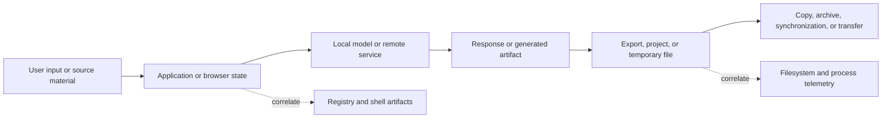

# Windows AI Artifact Forensics

## Reconstructing AI-assisted activity from files, application state, and the Registry

**Technical reference and sanitized workstation example. Research checked November 5, 2026.**

**[Read the complete write-up in one file](COMPLETE-WRITEUP.md).**

**Repository revision: 1.2.0.** Start with the [artifact catalog](docs/artifact-catalog.md), then follow the [worked cases](docs/worked-cases.md) and [acquisition bundles](docs/acquisition-bundles.md). Real workstation observations, synthetic cases, tested utilities, and pending application lab captures are labeled separately.

An AI application's visible export folder is only one part of its forensic footprint. A useful examination also considers conversation stores, model caches, temporary material, browser storage, shell interaction, and execution telemetry. Those sources answer different questions: what was available, what was requested, what ran, what was saved, and which account or operator can be connected to the activity.

This repository provides a Windows-focused approach for investigations involving malicious hacking, impersonation, coercion, and child exploitation. It uses an owner-authorized workstation as a metadata example. **The example is an ordinary workstation survey; it makes no finding of wrongdoing.** Private conversation contents, images, credentials, browsing records, account identifiers, and personal filenames are excluded.

## Read the write-up

| Document | Coverage |
|---|---|
| [Central artifact catalog](docs/artifact-catalog.md) | Searchable path/format/inference/status index with a machine-readable JSON companion |
| [Acquisition bundles and templates](docs/acquisition-bundles.md) | Related-file sets, capture limits, evidence manifests, and claim/evidence records |
| [Worked cases](docs/worked-cases.md) | Two explicitly synthetic investigations, including cross-host joins and media handling |
| [Lab validation plan](docs/lab-validation-plan.md) | Reproducible benign application tests; actual application captures remain pending |
| [Static metadata inspection](docs/static-metadata-inspection.md) | Bounded header reader, benign measured fixture, malformed-input tests, and limits |
| [Media and transfer provenance](docs/media-and-transfer-provenance.md) | Derivative relationships, C2PA, cloud/remote actions, and transfer completion |
| [AI application storage](docs/ai-storage.md) | Ollama, LM Studio, Hugging Face, ComfyUI, AUTOMATIC1111, and browser/Electron storage |
| [Coding-agent CLI artifacts](docs/coding-cli-artifacts.md) | Claude Code, Gemini CLI, Copilot CLI, OpenCode, Aider, transcripts, settings, and temporary/session state |
| [IDE-agent artifacts](docs/ide-agent-artifacts.md) | Cursor, VS Code/Copilot, Cline, Roo Code, Continue, editor databases, and extension task stores |
| [Harnesses and tool infrastructure](docs/agent-harnesses.md) | OpenClaw, Hermes, goose, OpenHands SDK, LangGraph, MCP, hooks, and cross-host correlation |
| [Additional image-generation artifacts](docs/image-generation-artifacts.md) | InvokeAI, Fooocus, Forge, SwarmUI, kohya_ss, OneTrainer, and Diffusers output/training storage |
| [CSAM investigation application](docs/csam-investigations.md) | Sourced misuse context, model/adapter provenance, generation-versus-import evidence, and attribution |
| [Windows artifact reference](docs/windows-artifacts.md) | Exact paths, Registry keys, hive mapping, event IDs, and interpretation limits |
| [Secondary residue and alternate storage](docs/secondary-residue.md) | Thumbnails, temporary files, crash dumps, Recycle Bin, alternate streams, redirected folders, WSL, and Docker |
| [Observed workstation example](docs/local-example.md) | Verified paths on the example computer, including inaccessible and stale locations |
| [Expanded workstation example](docs/expanded-local-example.md) | Additional verified Copilot, Roo Code, native Hermes, IDE, and tray-application candidates |
| [Collection and analysis](docs/collection-and-analysis.md) | Preservation, metadata inventory, SQLite analysis, timeline construction, and a benign example |
| [Inventory helper](scripts/Get-AIArtifactInventory.ps1) | Bounded current-user metadata survey; no content parsing |
| [Example JSON](examples/workstation-metadata.json) | Sanitized output from the helper on the example workstation |
| [Supplemental observations](examples/supplemental-observations.json) | Additional bounded checks and two allowlisted configuration path settings |
| [Expanded inventory JSON](examples/expanded-workstation-metadata.json) | Separate current-user snapshot from collector revision 1.1.0 |

**Inclusion rule:** the storage chapters document general-purpose software behavior. The CSAM investigation chapter separately cites documented misuse. A listed application, model cache, or harness is not itself an indicator of offending activity.

## 1. Follow the data through the workflow

A practical starting model is:



Each arrow is a proposition to test. A folder containing a model and a script supports a different claim from a recovered request linked to a process event and a matching output file.

Use the following distinction throughout the examination:

| Finding | Example support | Remaining question |
|---|---|---|
| Availability | Model cache, application installation, configuration | Was the tool actually used? |
| Request or interaction | Conversation record, CLI input history, workflow graph | Was it submitted, imported, or merely stored? |
| Execution | Process telemetry and corroborating application records | Did the process perform the action of interest? |
| Output creation | Generated artifact, application record, filesystem activity | Which request or process produced it? |
| Distribution | Transfer records and destination-side corroboration | Did transfer complete, and who controlled the destination? |
| Attribution | Account/session evidence, device context, communications | Could automation, remote access, or another user explain it? |

Treat this table as an analytical framework. It is not a scoring system in which a fixed number of artifacts proves an allegation. Digital investigation depends on testing explanations against the available evidence, including competing explanations. [NIST's scientific foundation review](https://nvlpubs.nist.gov/nistpubs/ir/2022/NIST.IR.8354.pdf) discusses that approach.

## 2. Search beyond Downloads and Pictures

The highest-value locations are often application-specific:

| Location class | Examples | Why examine it? |
|---|---|---|
| User-level application state | `%USERPROFILE%\.lmstudio\conversations`, `%USERPROFILE%\.codex\sessions` | Requests, session records, or related state may exist without a manual export |
| Desktop application data | `%APPDATA%\LM Studio`, application-specific `%LOCALAPPDATA%` trees | Separate state, local storage, logs, and caches |
| Model/repository cache | `%USERPROFILE%\.ollama\models`, `%USERPROFILE%\.cache\huggingface\hub` | Model/repository availability and revision context |
| Configured output roots | ComfyUI `output`; AUTOMATIC1111 `outdir_*` settings | Generated files may be written outside standard user folders |
| Browser profiles | `History`, `IndexedDB`, `Local Storage`, `Service Worker\CacheStorage` | Web access, retained application state, and download context |
| Windows interaction artifacts | Jump Lists, LNK files, ShellBags, dialog MRUs | References to locations and files outside the application's own records |

The [application reference](docs/ai-storage.md) supplies sources and configuration exceptions for these paths. A default is a search candidate. Establish the effective path from the examined installation.

Resolve environment variables for the target user. On an offline image, the analyst's `%APPDATA%` and `HKCU` refer to the analyst, not the subject profile. Record explicit image-relative paths and hive provenance.

## 3. Keep configuration, data, and output separate

An examiner should establish at least four locations for each relevant application:

1. **Executable and version:** the program actually present at the relevant time.
2. **Configuration root:** settings, launch options, and path overrides.
3. **State and cache roots:** conversations, sessions, repositories, databases, or logs.
4. **Output destinations:** generated files, explicit exports, project files, and transfers.

These may reside on different volumes or in different user profiles. A Python wrapper can write a response to its working directory while the model cache remains elsewhere. A browser may retain a conversation reference without downloading a response. An image workflow can specify a filename prefix or a custom output directory.

Do not interpret every cache as a copy of user-generated content. Code caches and GPU caches have infrastructure roles. A model cache is ordinarily acquisition/availability evidence; the application or caller determines whether responses are saved.

## 4. Reconstruct paths and event order

For NTFS, relate directory entries and file metadata to retained change records. The MFT holds file information; the USN journal records types of filesystem change and can discard older records. It is a partial history, with possible aggregation of changes. [Microsoft MFT documentation](https://learn.microsoft.com/en-us/windows/win32/fileio/master-file-table), [USN journal documentation](https://learn.microsoft.com/en-us/windows/win32/fileio/change-journal-records).

Correlate that layer with the exact Registry and execution artifacts listed in the [Windows reference](docs/windows-artifacts.md). Keep these distinctions explicit:

- A saved path reference supports a narrower claim than successful file access.
- A configured startup command supports a narrower claim than execution.
- Process creation supports a narrower claim than a successful generation or transfer.
- A key LastWrite time is a key-level timestamp, not a timestamp for every value.
- Timestamp disagreement deserves investigation before it is labeled manipulation.

Preserve the raw time representation, conversion method, source timezone, and any observed clock discrepancy. Copying, archive extraction, synchronization, and parser behavior can explain differences. Document the basis for each claimed event instead of merging every timestamp into an unexplained chronology.

## 5. Handle databases as evidence sets

The example workstation contained versioned SQLite files under `.codex`, with adjacent `-wal` and `-shm` files. Their filenames are locally verified; their schemas and contents were not examined.

SQLite can retain committed changes in a WAL before they are checkpointed into the main database. A coherent acquisition must account for the database and relevant sidecars. Sequential copies from an actively changing application do not automatically constitute a consistent snapshot. Analyze acquired copies and preserve the original set. [SQLite WAL documentation](https://www.sqlite.org/wal.html).

Likewise, a directory named `Local Storage\leveldb` is not a SQLite database. Use a parser appropriate to the captured storage format and version. Avoid guessing a schema from an application name.

## 6. What this computer actually demonstrated

The authorized survey observed:

- LM Studio conversation JSON and a separate roaming application-data tree.
- Ollama model storage and CLI history, while the checked local Ollama directory was empty.
- Codex session/state candidates, SQLite sidecars, attachments, and visualization directories.
- A ComfyUI CLI configuration referencing a workspace absent at the checked path.
- Zero direct files in the Windows Recent root, alongside files in both Jump List subdirectories.
- Access-denied results for protected artifacts that must remain distinct from absence.

These findings are explained in the [local example](docs/local-example.md). Counts are live observations from November 5, 2026, not durable properties of the machine.

## 7. Connect the workflow to the investigation

For a suspected intrusion, examine whether a recovered request relates to a particular script, whether that script ran, and whether execution aligns with activity on the affected system. For suspected exploitation, examine whether the supported workflow connects source material, communications, generated artifacts, and transfer activity to the harm being investigated.

Keep technical reconstruction and intent separate in the report. A model's presence, a folder label, an apparent prompt, or an embedded workflow graph cannot independently establish a person's actions or purpose.

Useful reporting language states both the observation and its limit:

> A JSON file was present in the application's documented conversation directory. Its contents were not examined in this survey; the observation establishes a candidate record for authorized analysis.

> The configuration referenced an output workspace absent at the checked location. The survey did not determine whether it had been moved, removed, or stored on an unavailable volume.

> No Sysmon EVTX file was observed at the checked default path. Historical installation, alternate destinations, and forwarded telemetry were not assessed.

## Reproduce the metadata survey

Run from the repository root in Windows PowerShell or PowerShell:

```powershell
.\scripts\Get-AIArtifactInventory.ps1 -OutputPath .\inventory-private.json
```

The helper inspects a fixed current-user candidate list and reports metadata. Review its help before use. Running it on a live system generates normal operating-system and shell traces. Its output is an inventory, not an evidence acquisition or a malicious-activity detector.

The checked-in example deliberately omits private content. Keep case material outside a public repository.

The helper was validated in Windows PowerShell 5.1 and PowerShell 7. The [validation record](VALIDATION.md) describes the checks and their limits.

Revision 1.1.0 adds coding-agent, editor, and harness candidates while preserving the initial observation files. It reports metadata and selected environment-variable presence; it does not resolve every custom root, parse private content, or search every project on disk.

Revision 1.2.0 adds the catalog, acquisition templates, synthetic worked cases, media/transfer guidance, and a tested static-header reader. See the [validation plan](docs/lab-validation-plan.md) before treating a documented application path or synthetic case as a reproduced application finding.

## Maintenance

Paths and schemas change. Record the installed application version, effective configuration, source retrieval date, parser version, and acquisition method for each examination. Links to `main`, `master`, or `latest` document a moving implementation; pin the relevant commit when citing a particular build in a case report.
