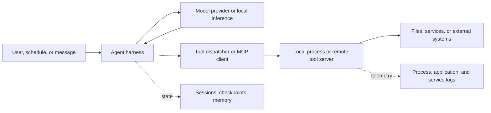

# Agent harnesses, gateways, and tool infrastructure

**Reference checked November 5, 2026.** This chapter documents storage candidates and interpretation, not local findings. Consult the [expanded workstation example](expanded-local-example.md) for the paths actually observed.

## Reconstruct the application around the model

For this write-up, a **harness** is the application logic that assembles context, manages a task/session, calls a model, dispatches tools, and records or resumes the work. A model name alone rarely identifies all of those layers.



Map the initiating surface, runtime host, account, model endpoint, tool host, working directory, state root, and output destination separately. An editor on Windows can connect to a service in WSL, which can dispatch a tool inside a container and save a file through a host bind mount.

## OpenClaw: current database versus legacy session files

The current session reference identifies:

| Candidate under the effective state root | Meaning |
|---|---|
| `agents\<agentId>\agent\openclaw-agent.sqlite` | Current runtime session rows and transcripts |
| `agents\<agentId>\sessions\` | Archived transcript files |
| `agents\<agentId>\sessions\sessions.json` | Legacy row-migration source |

The normal state root is `~/.openclaw`, commonly `%USERPROFILE%\.openclaw` for a native process. A retained legacy JSON file does not establish that it is the active store. Current documentation distinguishes session start, last interaction, and last mutation times; avoid treating them as interchangeable. [OpenClaw session management](https://docs.openclaw.ai/concepts/session).

The state directory and workspace are separate locations. The main configuration is normally `<state>\openclaw.json`; external providers and messaging services can retain additional records. The authoritative machine is the Gateway host, which may differ from the desktop used to control it. [Storage FAQ](https://docs.openclaw.ai/help/faq/where-things-live-on-disk).

`OPENCLAW_HOME`, `OPENCLAW_STATE_DIR`, `OPENCLAW_CONFIG_PATH`, `OPENCLAW_WORKSPACE_DIR`, and named profiles affect path resolution. Named-profile defaults can use `~/.openclaw-<profile>`. Preserve the effective configuration without publishing credentials. [OpenClaw environment reference](https://docs.openclaw.ai/help/environment).

Neither a tray application's directory nor a browser dashboard establishes the Gateway's storage location. Record that relationship before interpreting missing `.openclaw` files.

## Hermes: native Windows has a different default

The current developer reference resolves Hermes home through the application resolver, including context overrides and `HERMES_HOME`. Its platform defaults differ:

```text
Native Windows:  %LOCALAPPDATA%\hermes
macOS/Linux:     ~/.hermes
```

The canonical database is `<effective-home>\state.db`, with existing `state.db-wal` and `state.db-shm` companions. Named profiles isolate state beneath the effective profile home. Current storage uses SQLite in place of the earlier per-session JSONL approach. [Hermes session-storage reference](https://hermes-agent.nousresearch.com/docs/developer-guide/session-storage).

Configuration candidates include `<effective-home>\config.yaml`; resolve profile and configuration precedence for the installed release. [Hermes configuration](https://hermes-agent.nousresearch.com/docs/user-guide/configuration).

Exported session files form a separate evidence class. Current documentation distinguishes machine-oriented exports from readable display exports, including differences in retained message history. A file that resembles another agent's transcript format can be an export rather than a native record from that agent. [Hermes session documentation](https://hermes-agent.nousresearch.com/docs/user-guide/sessions).

The local example demonstrates why a home-directory-only search is insufficient: the Windows-native root existed while `%USERPROFILE%\.hermes` did not.

## goose: shared conversation store, separate operational logs

Current original-project documentation lists these Windows locations:

| Artifact | Candidate |
|---|---|
| Session database | `%APPDATA%\Block\goose\data\sessions\sessions.db` |
| Command history | `%APPDATA%\Block\goose\data\history.txt` |
| Runtime logs | `%APPDATA%\Block\goose\data\logs\` |
| Desktop operational log | `%APPDATA%\Block\goose\logs\main.log` |

CLI and desktop sessions share the conversation store. Documentation also describes migration from earlier JSONL session files, which can remain after migration. A desktop log and the session database answer different questions. [Original goose logging documentation](https://raw.githubusercontent.com/aaif-goose/goose/main/documentation/docs/guides/logs.md).

Preserve the installed version and acquired schema. Do not interpret every log entry as successful tool execution or treat an older JSONL file as the complete current session.

## OpenHands SDK: resolve the caller and persistence directory

Current SDK source implements `get_user_persistence_dir()`: `OH_PERSISTENCE_DIR` can override the supplied/default root; absent that, the function uses the caller's supplied default or `~/.openhands`. Relative overrides are anchored to the initial working directory, and some callers cache the result. [Original SDK path resolver](https://raw.githubusercontent.com/OpenHands/software-agent-sdk/main/openhands-sdk/openhands/sdk/utils/path.py).

That source establishes a resolver, not one universal conversation-file layout for every OpenHands UI, CLI, SDK application, or server version. Identify the entry point and follow its configuration and storage implementation. With remote execution, preserve the server-side state and workspace mapping as well as the client-side records.

## LangGraph and custom orchestration

LangGraph persistence is configured through a checkpointer. State is organized with thread/checkpoint context; storage can use different backends. There is no basis for assuming every LangGraph application writes an `agent.db` in the user's profile. [LangGraph persistence documentation](https://docs.langchain.com/oss/python/langgraph/persistence).

For a custom harness, examine the application configuration or source for the selected storage backend, connection/path configuration, working directory, state serialization, and output calls. Configuration can identify a remote database or a relative file path; resolve it on the host and account that ran the harness.

Application-level checkpoints may capture context used for continuation rather than a full audit of every external effect. Correlate them with tool results and destination-side evidence.

## MCP, hooks, skills, and tool servers

MCP uses a host/client/server architecture. Tool servers can run locally or remotely, and the protocol does not define one universal transcript directory. [MCP architecture](https://modelcontextprotocol.io/docs/2026-07-28/learn/architecture).

Use this examination map:

| Layer | Examine | Interpretation limit |
|---|---|---|
| Host configuration | Configured server endpoints, command paths, settings provenance | Configuration establishes a connection candidate |
| Harness records | Tool-call identifiers, arguments, return records, errors | A requested call differs from a completed external action |
| Local server | Executable/package version, child processes, its own output/log paths | Host transcript may omit server internals |
| Remote server | Authorized service records and destination evidence | Endpoint-side effects may leave no local payload |
| Hooks and task scripts | Referenced scripts, triggers, repository version | Presence does not establish that a trigger fired |
| Skills/instructions | Source files, loaded configuration, version | Content is context; independent evidence is needed to show its effect |

Tool output is evidence supplied by another component. Preserve whether it is a structured response, logged text, an imported record, or corroborated telemetry. A transcript entry saying a file was saved is weaker than a matching acquired file and process/file-write evidence.

Exact Claude Code, Gemini CLI, Copilot, OpenCode, and editor configuration candidates are in the [coding CLI](coding-cli-artifacts.md) and [IDE-agent](ide-agent-artifacts.md) chapters.

## Minimum correlation record

For each material action, retain the host, account/session, harness version, session or run ID, parent/child relationship where available, request/response identifiers, tool name, tool host, process identity, working directory, source/output identity, and time semantics.

Preserve unresolved links. A subagent's request can appear in one store, its execution in another host's telemetry, and its output in a third service. Reconstruct those edges before attributing the entire workflow to a person.
